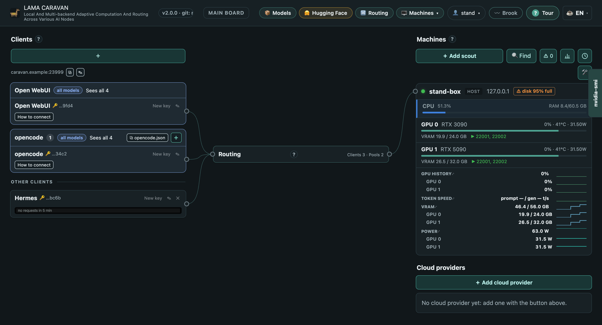
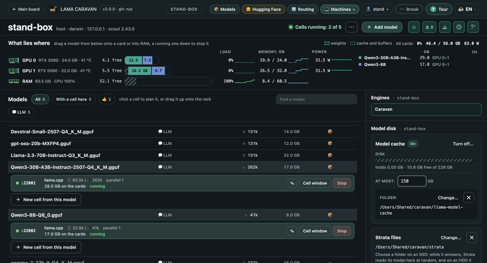
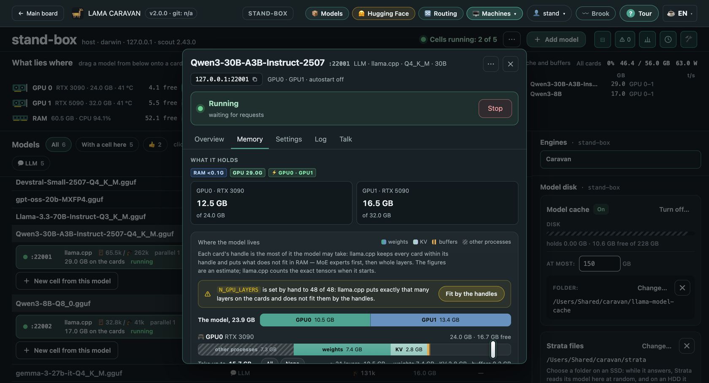
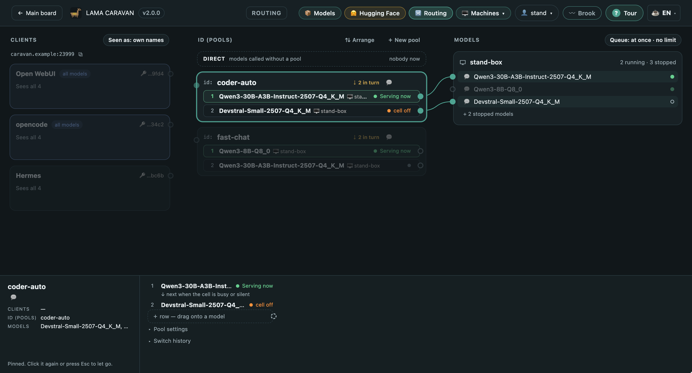
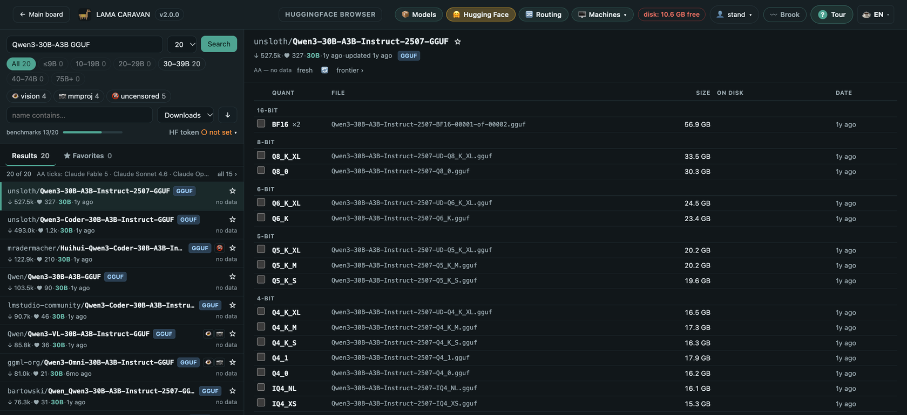

# LAMA CARAVAN

**L**ocal **A**nd **M**ulti-backend **A**daptive **C**omputation **A**nd **R**outing **A**cross **V**arious **A**I **N**odes.

Repository/service slug: `lama-caravan`.

Local control plane for LAMA CARAVAN: controller topology, proxy routing, and
per-host `llama.cpp` server cells.

The app is intentionally dependency-light: three Rust programs on plain threads,
and static HTML/CSS/JS.

## Why LAMA CARAVAN

The problem it solves: you have AI agents (OpenClaw, Hermes, anything speaking
the OpenAI API) burning tokens all day, a couple of machines with GPUs standing
mostly idle, and cloud subscriptions that are metered, rate-limited and see
your prompts. LAMA CARAVAN glues that into one system where **tokens are
processed wherever it makes sense right now** — locally when your hardware can
take it, in the cloud when it can't.

What that gives you in practice:

- **The OpenAI API, the way companies' gateways speak it.** A client gets one
  address and a key of its own, made with ＋ on the board, and sees every pool
  and every model that runs, but what is blocked for it in Routing: `model` in a
  request picks a pool or a model by its name, as OpenAI's API picks a model, and
  `GET /v1/models` lists them with what each does. Errors come in OpenAI's shape —
  401 for a key, 403 for a pool or a model blocked for the key, 404 for a model the
  caravan has not, 503 for one that does not run now, 429 with `Retry-After` at a
  limit, 400 for work a model does not do — and say nothing of the providers,
  accounts and machines behind a pool.
  Any OpenAI SDK works as is: set `base_url` and `api_key`.
- **Stable endpoints, whatever runs behind them.** A client keeps its address
  and its key — and never needs reconfiguring again. Swap the model, move it to
  another machine, reroute to the cloud: the client doesn't notice.
- **Cloud models for ANY app, not just agents.** The caravan holds the
  keys/OAuth, picks the pool's row, meters the spend and logs the requests: a
  transcription tool, a translator overlay or an IDE plugin calls the entry with
  a key of its own and speaks to `gpt-…`/OpenRouter/Anthropic without owning a
  single credential. Every app comes in the same way: one address, its own key.
  Chat Completions and the Responses API (`/v1/responses`, what Codex CLI
  speaks) both work, on API-key and subscription rows alike; a reasoning effort
  a model does not take goes as the nearest one its provider lists.
- **Local ⇄ cloud routing you can draw.** In Routing a client calls a pool or a
  model by the request's `model` — every one but what is blocked for it — and a
  pool is a list of rows — a subscription's
  model or a machine's model, mixed as you like. A machine's model is called by
  its name, not by a port: its scout serves every model of the machine at one
  address, its cells are the model's copies, and a cell moved to another port
  touches no pool. The proxy tries the rows from the top and
  moves on at a limit, when a model is off, while it is busy and a later row
  is ready (at once, or after a patience you set), or on an error before the
  first byte; a started stream is never cut. A change holds from the next
  request, with no restart.
- **Queues instead of timeouts — one GPU can serve many agents.** Requests
  line up in each model's queue, and the waiting ones are *held*
  rather than dropped. See [One GPU, many agents](#one-gpu-many-agents) below —
  it is the feature people are most surprised by.
- **Money and privacy.** Local tokens cost electricity; the cloud is used only
  where you routed it. Usage & spend statistics show tokens/requests/costs per
  agent and per backend, so the routing pays for itself visibly. Sensitive
  agents can be pinned to local-only routes — those prompts never leave the LAN.
- **Your whole zoo of hardware as one fleet — client GPUs included.** Put the
  caravan-scout sidecar on a box whose GPU or CPU you want in the pool: its hardware and cells appear on
  the board, and you launch cells there remotely — **any of the eleven runners,
  on that host's own GPU or CPU**, models cached and shipped from the
  controller. Before starting you see a "will it fit" estimate against BOTH
  pools (RAM and VRAM) of that exact host; a running cell shows what it
  *actually* holds, measured per-process from `nvidia-smi` — on the
  controller and on scout hosts alike. A machine that only *runs* agents
  needs nothing installed — see [Deployment model](#deployment-model-a-scout-only-where-there-is-hardware-to-share).
- **Eleven runners, one lifecycle.** A cell is not just llama.cpp — pick the
  engine per cell, and they all share the same cards, health checks,
  start/stop/schedule machinery and memory math:
  - 🦙 **llama.cpp** — GGUF; a model split across several cards and RAM, each card's share set by a handle on a map
    that places the model as llama.cpp's own fitting will; MTP speculative decoding, KV-cache control
  - 🌱 **PrismML** — the PrismML llama.cpp fork for Bonsai GGUF (PQ2_0/PTQ1_0),
    in an isolated runtime installed on first start ([docs/prismml.md](docs/prismml.md))
  - ⚡ **vLLM** — safetensors (AWQ/GPTQ everywhere, NVFP4/FP8 on new GPUs),
    continuous batching; provisioned into its own venv on first start, with
    pinned version + one-click update/rollback
  - 🪨 **Strata** — Qwen3.8-Flash-Next (177B, GSQ-RCO 2- to 3.5-bit GGUF, and
    Unsloth's ~4-bit packs) on one card, its experts streamed to the card; the
    engine is installed once with Strata's own `setup.sh`, and the model and its
    MTP draft layer come from the library like any GGUF. Which packs there are
    (the original, the Coder, Swift 1.5, Unsloth's) and what each asks of the
    machine: [docs/strata-models.md](docs/strata-models.md)
  - 🦾 **GR00T** — a robot policy (NVIDIA GR00T N1.7): camera frames, the
    robot's state and an instruction in, a chunk of actions out, at
    `POST /v1/robot/predict` — through the entry like any model
    ([docs/robot-policy-api.md](docs/robot-policy-api.md)). NVIDIA's own
    Isaac-GR00T runtime is installed once (`scripts/install-gr00t.sh`); the
    checkpoint and its Cosmos-Reason2 backbone come from the library
  - 🎙️ **whisper** — speech-to-text (faster-whisper); the model downloads
    itself, language is picked per request
  - 🌙 **moonshine** — CPU-only speech (Moonshine v2), both directions: STT
    that beats Whisper large-v3 accuracy on English at 250M params (also
    es/zh/ja/ko/vi/uk/ar — no Russian), and stock-voice TTS for 20 locales
    including Russian and Ukrainian — GPUs stay free for LLMs
  - 📝 **transcribe.cpp** — GGUF speech-to-text on the ggml runtime; one build
    runs GigaAM, Parakeet, Canary, Whisper and more, chosen by the file in the
    ordinary model picker. The best free **Russian** recognizer of the set —
    GigaAM-v3 near 8% WER against 21-25% for whisper large-v3, cased and
    punctuated, from a 260 MB file
  - 🌐 **Seamless** — speech to translated text in one model (SeamlessM4T v2):
    a Russian sentence in, an English transcript out
  - The cells that hear — moonshine, transcribe.cpp, Seamless, LFM2.5-Audio — read a WAV themselves and webm, ogg,
    mp3 or m4a (what a browser and Open WebUI send) through the machine's `ffmpeg`, refusing with the reason where
    there is none; whisper reads them all through faster-whisper
  - 🔄 **NLLB** — text translation (NLLB-200), the same card and lifecycle as
    every other cell
  - 🛠️ **Custom command** — any process that listens on `127.0.0.1:$PORT` becomes a
    managed cell: health-checked, logged, scheduled, restarted (the scout reaches a cell on its machine's loopback; the
    network sees one port of the machine, the scout's)
- **🦜 Voice clone is a runner.** XTTS-v2, CosyVoice2 or F5-TTS, the engine picked on its tab: a text read out in
  a voice taken from a few seconds of a sample, through OpenAI's `POST /v1/audio/speech` — the board's 🎙 window
  and Open WebUI talk to it as to Qwen3-TTS — with a voice kept on the machine under a name, and the voice app's
  own `/v1/audio/speech-clone`. Until 1.3.611 these were custom commands from three presets. CosyVoice2 is the
  engine whose weights allow commercial use (see [Model licences](#model-licences)); on Blackwell GPUs its venv
  needs the cu128 torch noted in [Tested versions](#tested-versions).
- **Talk to a voice model from its card.** 🎙 on a running cell of a model that speaks or hears — Qwen3-Omni,
  Step-Audio 2, LFM2.5-Audio, Qwen3-TTS, the speech recognizers, a llama.cpp model whose server says it hears —
  opens a window over the board: record a question in the browser, hear and read the answer, see how long it took.
  The controller asks the cell (`POST /api/cell-talk`), so the https board talks to a plain-http cell. A Qwen3-TTS
  cell reads a text in the voice of a sample recorded there — on your word that the voice is yours or its owner
  agreed — and keeps that voice under a name, for Open WebUI or any client to ask for.
- **One compute-target switch.** Every cell picks **CPU / GPU / auto** with one
  control (options a runner can't do are disabled); a multi-GPU host fans out
  into per-card chips or a checklist, and llama.cpp gets the right
  device/split/threads flags written for it.
- **Models from HuggingFace in two clicks.** The built-in HF browser searches
  GGUF repos, shows quants with sizes and benchmark badges, downloads
  multi-part files straight into the controller's model directory.
- **You see everything.** A live topology board (cables light up with real
  traffic), per-request history with timings and error kinds, incident badges,
  GPU/CPU/token-speed monitors.
- **Little to install.** The controller is two programs and a folder of static
  files, the scout one static program; no database server, no external services,
  Docker optional (see the quick start). State lives in plain JSON files
  (hot-reloadable, git-diffable, backed up by copying), and a machine with a scout
  has one systemd user unit.

A concrete day with it: your coding agents hammer a local Qwen on the desktop
GPU all night on a schedule window; in the morning the schedule flips them to
a subscription provider while the GPU serves a bigger model for a research
agent; one agent with confidential data stays pinned to the local route; a
transcribe.cpp cell turns Russian speech into cased, punctuated text
(GigaAM-v3) while a CosyVoice cell answers in a cloned voice — a
voice-translation app on the LAN finds both by the engine self-ID their
`/health` publishes; and the spend chart shows what all of that would have
cost in cloud tokens.

The long version of that day — with the Routing page that implements it — lives in
[docs/day-with-the-caravan.md](docs/day-with-the-caravan.md).

## Deployment model: a scout only where there is hardware to share

**caravan-scout (`rust/crates/scout`) runs only on machines that share
hardware.** It is the sidecar of a box with a GPU (or
spare CPU) you want in the pool: it reports the machine — GPUs and what runs
on them, CPU/RAM, cells, the llama.cpp build — runs the cells the controller
configures, and keeps llama.cpp current.

Adding such a box takes two steps. **Machines → ＋ Add scout** on the board shows
one command; run it on the box (Linux on x86_64): `curl -fsSL
<controller>/scout/install.sh | bash`. It takes the scout from the controller,
installs what the machine needs, starts the scout and prints its address and
port. Back on the board: that address, Connect — the controller pairs the scout
itself and hands it the fleet token. From then on the box is a machine node, and
its cells are launched from there; its ✕ lets go again. A new version comes by
itself: once the controller runs a new release, it hands it to each machine whose
scout in it is another program, at that machine's next report, and to a busy one a
little later. The machine's ⋯ menu, **Update the scout**, does the same by hand.
Cells that run keep running while it restarts, and it restarts only once the requests
passing through it are answered, ten minutes at the most. A controller whose release carries
no scout has none to hand out and says so: [Install On the controller](#install-on-the-controller)
says how a release gets one.

A machine that merely *runs agents* installs nothing. Each agent is a client
of the entry, made **on the board**: ＋ in the Clients column asks a name,
then shows its key once. The agent calls the entry's
address with that key — that is the whole integration. A client is known by its
record's id and has no port number of its own; a route of the older kind, made with a
port of its own, is retired at the controller's start: make it a client. A machine that does both shows up
twice: as a machine with its hardware and as its agents' client cards.

Why: fewer moving parts on machines that gain nothing from a sidecar, a
clearer support boundary ("what do I need to install?" — nothing, unless you
are sharing a GPU), and expectations that match what the feature does: the
scout is a hardware donor's sidecar, not a registry of everything that runs on
your network.

Since scout 2.0 (controller 1.3.353+) this is the whole architecture: a scout
says nothing about agents; client and agent cards are the operator's records,
and no report creates, rewrites or deletes them; a client's liveness is its
agents' traffic — idle after 12 hours without a request, the same on the
board and in Routing; a machine whose scout went silent is marked on its
node, and its ✕ lets go of the scout and removes the machine without touching any client.

## One GPU, many agents

<a id="one-gpu-many-agents"></a>

Three agents ask for 30 minutes of GPU each, at the same moment, and you own
one card.

Without a queue you get one answer and two casualties: the other agents sit
watching a silent socket, hit their own read timeout at a minute or two, and
give up with *"nobody is processing my tokens"*. The work is not slow — it is
**lost**, along with whatever chain of steps the agent was in the middle of.

With the caravan the same three finish in about 90 minutes, one after another,
and nobody drops:

```
agent A ──┐                    ┌── 0–30 min ── answer
agent B ──┼── one proxy queue ─┼── 30–60 min ─ answer
agent C ──┘   (per upstream)   └── 60–90 min ─ answer
              waiting agents stay connected
```

**How the waiting one survives.** A queued request is not a paused request: the
proxy answers immediately and keeps the stream alive, sending a keepalive frame
about every 20 s until real tokens start flowing. The shape of
that frame is the whole trick, and it was found the hard way — clients reset
their read timeout
**only on chunks that carry actual token text**. SSE comments, role-only chunks
and `content: null` are ignored by them, so the obvious keepalives did nothing.
The caravan sends a `reasoning_content` delta instead: it counts as token
activity for the timer, but lands in the model's *thinking* channel, so it
never pollutes the visible answer. From the agent's side the request looks
exactly like a slow model that is already working.

**What bounds the wait.** By default, the client's *own* timeout: the request
waits until the client gives up. Routing says how long the clients wait — one
setting for all, 60 minutes unless you say otherwise; give your agents that
timeout — and shows by it how long a running request's client still waits.
Set a limit for the models' queue and a request with nowhere else to go waits
that long, then gets an honest 503.

**What the queue is not.** It is not one global line: each request competes
only for the slots of *its own* model, and the slot count is read from that
server's real `--parallel`. Inside a model's queue the order is plain arrival
order: at the entry no request has priority, and none takes a slot back from
another. An agent that hangs up leaves the queue
immediately instead of holding a place. The queue is the model's, however many
pools send it requests, and a request whose pool has a ready row further on
does not wait to the end — after the patience (0 by default: at once) it goes
on to that row. The patience and the limit are one pair for every model, set
in seconds and minutes from the head of Routing's Models column. Routing shows
each model's queue: "1 of 1 · 2 waiting" on its line, and in its strip who
holds the slots and each waiting request on a scale up to the moment it
leaves.

**The honest part.** Everything still takes 90 minutes: the queue buys you
*completion instead of collapse*, not speed. And the keepalive only exists for
**streaming** requests — a non-streaming client sitting in the queue is still
just a client waiting on a silent socket, and survives only if its own timeout
is long enough. Details in [docs/backend-proxy.md](docs/backend-proxy.md).

## Quick start

The fastest way to look around: the controller with its proxy, no models inside. Neither
program runs a model itself: cells run on machines with a scout — the controller's own
machine included, with a scout installed on it like on any other.

With Docker, which builds it all, the scout it hands out included:

```bash
git clone https://github.com/thepr0metheus/lama-caravan.git
cd lama-caravan
TZ=Europe/Berlin LLAMA_TOPOLOGY_SERVER_IP=<this-machine's-address> docker compose up -d --build
# open http://<this-machine>:7990
```

Without it, you build it with the compiler `rust/rust-toolchain.toml` names:

```bash
git clone https://github.com/thepr0metheus/lama-caravan.git
cd lama-caravan
(cd rust && cargo build --locked --release -p admin -p proxy)

# A release is one folder: the programs, the board's files, the cell servers.
mkdir -p ~/caravan/release/bin ~/caravan/data
cp rust/target/release/caravan-admin ~/caravan/release/
cp rust/target/release/caravan-proxy ~/caravan/release/bin/
git archive HEAD static cells VERSION | tar -xm -C ~/caravan/release

CARAVAN_ROOT=~/caravan/release CARAVAN_DATA_DIR=~/caravan/data ~/caravan/release/caravan-admin
# open http://<this-machine>:7990
```

`CARAVAN_ROOT` says where the release is. `CARAVAN_DATA_DIR` is where all state lives:
config, accounts, token history, logs and downloaded models; the proxy does not start
without it. The first page is `/setup`, which makes the first account, and the entry
opens by itself on port 23999.

Models are **not** served by the controller: on each GPU machine run the command
**Machines → ＋ Add scout** shows, then enter the address it prints there: the controller
pairs the scout, and its cells appear on the board. A release hands out a scout only when
it carries one: [Install On the controller](#install-on-the-controller).

In a container two more settings are required, `TZ` and `LLAMA_TOPOLOGY_SERVER_IP`:
[docs/operations.md](docs/operations.md#controller-in-a-container).

## Models directory layout

`/hf` downloads land as `<model-name>/<author>/<quant>/<file>.gguf`, e.g.
`gemma-4-12B-it-GGUF/bartowski/Q8_0/gemma-4-12B-it-Q8_0.gguf`. When adding
models by hand, any subfolder under the models dir is scanned — but following
the same layout keeps the model pickers, the disk-cleanup modal and
multi-part grouping tidy (parts `…-00001-of-00004.gguf` belong together).
A repository with many files is read to its last page, and a gated one (its terms are accepted on its
Hugging Face page) opens that page in a new window when the hub refuses its files.

## How a model reaches a machine

The models live with the controller, in its models directory. A machine with a scout needs no share mounted: it gets
what it runs through the controller, over HTTPS, in one of two ways. The machine's page chooses.

- **With a cache** (the default). The scout copies the model to its own disk the first time a cell asks for it, then
  starts from the copy. A limit in GiB, or a number of last models, says how much it keeps; the oldest unused goes first
  when a new copy needs room.
- **With no cache** (*Turn off*). Nothing lands on the disk, and what the cache held goes. The scout shows the
  controller's files as a read-only folder, a FUSE mount, and the cell reads its model from there as it would from a
  disk: only the parts it asks for cross the network, into the system's page cache and then the card. A second start of
  the same model reads from the page cache and takes seconds. The machine needs `fuse3`; without it, or when you prefer
  it, name a folder where the models directory is mounted, and the cell reads from there.

The mount sits in the scout's folder (`library-view`), so `du` counts what it shows: use `du -x`, or `df`, to see the disk.

Strata keeps its models in a folder of its own, chosen on the machine's page (*Model disk → Strata files*), whatever the
cache does: while it answers it reads its model there at random — its table of n-grams alone is 29 GB — and through the
controller or from an HDD it stalls, so the folder belongs on an SSD; the row says so, and warns in red when the system
says the disk spins. A Strata cell copies its model there on its first start and the copy stays after the stop, up to the
folder's limit — 300 GB unless you change it in the row: a new model that does not fit makes room from the models not used
longest, and one bigger than the limit is refused before a byte is copied, in words that name the sizes. The disk is
written once per model, and Strata's pack of about 2.3 GB once per cell and model; answering only reads. Until a folder
is chosen the row is red and the controller starts no Strata cell there, saying where to choose it. Both folders can be
changed in two ways — the files move with it (the scout copies them in the background, the page shows how far, and a move
that fails leaves the old folder as it was) or they are deleted — and ✕ removes a chosen folder: its files go, the cache
goes back to the folder it lies in by itself, and Strata waits for another. The controller keeps both folders and
Strata's limit, and a scout installed again gets them back.

An InferSSD cell, the other server of DeepSeek-V4.1-Flash beside Strata · DeepSeek, keeps its model in the same folder:
it reads the model's experts from the disk while it answers, so it needs the same fast disk, and a DeepSeek-V4.1 GGUF opens
both tabs. Its launcher (`cells/run_inferssd.sh`) builds wici-ai's engine on the machine at the first start, from the source
of one pinned commit (tag v0.1.1), in 2–12 minutes; the build needs the CUDA toolkit and liburing's headers, which the
machine's owner installs once (`sudo apt install liburing-dev`). It runs on the one card the form pins and takes it whole.

## Screenshots

These are from 2.0.0 (2026-11-03), taken on [the stand](docs/stand.md): the machine (`stand-box`), its two
cards, the entry's address and the clients are made up, and the models are GGUF headers with no weights
behind them — a stand's, not a real fleet's. Its "disk 95% full" is the laptop the stand ran on.

The main board, in three columns — the entry's address and its clients on the left (Open WebUI and
opencode are built in, any other client gets a key of its own), each with its recent requests as marks;
the Routing card in the middle, with how many clients and how many pools there are; on the right the
machines, each card with what runs on it and its history, and the cloud providers:



A machine's page: one rack across the page, a lane per card and one for the RAM, with what lies where
and each card's load, memory and power at its end. Under the rack a launch is built for the model picked, a step at
a time from one shelf — an engine, a quant and a set of settings, each dragged down into it — and carried up onto a card
or the RAM as a cell is, then started. Under it
every model of the library with its work, the longest context it was trained for, its size and its cells. On the
right the engines and the model disk: the cache with its limit and its folder, and the folder for Strata's files
apart from it:



A cell's window: its state, and tabs for its memory, its settings, its log and a chat with it. The memory
tab shows where the model lives — what each card holds, the handle that caps a card, and what a flag set
by hand changes. The settings tab has every flag of the runner explained and searchable; «Open all
settings…» opens the cell editor: the compute target, the runner row (llama.cpp / PrismML / vLLM / Strata / Strata · DeepSeek / InferSSD / GR00T /
whisper / moonshine / transcribe.cpp / Seamless / NLLB / custom), the mmproj and the MTP draft of a
multimodal GGUF, the schedule window and the exact command it will run:



A new cell starts from «＋ Add model» on a machine: a wizard asks what the model is for, lists the
models of that job with the context each was trained with and what it would weigh with its cache,
proposes the largest window the cards hold whole, picks the runner made for the model, and puts the
settings that move the memory beside the machine's map — every other flag of llama.cpp folded under
them, a star bringing any of them up. It drives the same cell editor: «Full form…» opens it with
everything set.

Routing — three columns: the clients, the pools ("ID (Pools)": a pool's name is the model id a client puts in
`model`) with «Direct» on their top — the models clients call by their own name right now — and the models. A
client's card says how many models it sees and what is blocked for it, and "＋ Block" chooses that. The cables
show for a card pinned by a click and while requests run, never at rest. A click on a card pins its path — the
clients that called it, its pools, its models lit, the rest stepped back — and its details in the strip under
the columns: for a pool its rows as the proxy says them, when it goes on to the next row, "＋ row", the pool's
settings and its switch history (in the picture, `coder-auto` is pinned).
A subscription's limits are drawn once on its card, one small bar for a window, with a red tick where its models stop;
a model's own two levels stand in its strip, and a model that is on its switch level wears "↓ yielding". With
nothing pointed at or pinned the strip is hidden:



The built-in Hugging Face GGUF browser: a search with size buckets and tags, and the files of a
repository by quantization, with their sizes:



## Requirements

| Component | Requirement |
|---|---|
| Controller OS | Linux, tested in a container on `debian:bookworm-slim`; controller-only, cells live on scout hosts. It also builds and runs on macOS: that is [the stand](docs/stand.md) |
| Rust | to build the programs: the version `rust/rust-toolchain.toml` names |
| Python | none on the controller. `python3` on a machine with a scout, for the cell servers and the install scripts: the scout's installer brings it |
| llama.cpp | a `llama-server` build **b400+** (needs `--chat-template-file`; see [Tested versions](#tested-versions)) |
| GPU serving | NVIDIA driver + `nvidia-smi` for telemetry; CUDA build of llama.cpp (CPU-only also works) |
| Scout hosts (share a GPU/CPU) | Linux on x86_64 with `systemd --user`: the static `caravan-scout`, by the command of ＋ Add scout. On another system build `rust/crates/scout` yourself: it runs on macOS too, with no installer. A scout on the controller's own machine (2.24+, 2.25+ to say why it lists no card): the controller powers it, reads and updates its GPU driver and reads its cards and processes through that scout |
| Reading a model with no copy on the machine | `fuse3` on the scout host; see [How a model reaches a machine](#how-a-model-reaches-a-machine) |
| Agent-only machines | nothing to install — the agent calls the entry with its key |
| Browser | any modern browser — native ES modules, no build step |
| Storage | plain JSON files; no database server required |

## Tested versions

The exact versions the development fleet runs — re-verified and updated here
whenever a component is upgraded (last verified: **2026-11-08**):

| Component | Verified version |
|---|---|
| llama.cpp | `0.8.0-dev` (build 2744, commit `8642541b2`, built 2026-11-02), CUDA build — updated through the GUI Update-build button; verified live with NVIDIA-Nemotron-3.5-Bolt-74B-A9B (24 GB GGUF with its mmproj), which the build before could not load — its GGUF names `nemotron_h_moe.expert_used_count` per layer, "wrong type arr but expected type u32": loaded from the machine's cache in 45 s, 122 tokens/s decode on the RTX 5090. This build dropped `--mmap`, `--no-mmap` and `--mlock`; the controller writes `--load-mode` instead, and `scripts/check_llama_flags.py` holds every flag it writes to this build's own help (`contract/llama-server-help.txt`). The Linux client still runs `b9947` until its own ⇪ chip is pressed |
| CUDA toolkit | 12.6 |
| NVIDIA driver | 615.71.09 (the GPU machine, as nvidia-smi says it on 2026-11-03), 580.159 (client). Under Secure Boot the driver metapackage is not enough: the Canonical-signed `linux-modules-nvidia-610-open-generic-hwe-24.04` must come with it, and no DKMS build may shadow it — `updates/dkms/` outranks `kernel/` in the module search path. A kernel from the security pocket arrives before its signed modules, whose driver lives in the updates pocket: that kernel boots without the GPU. The DKMS from NVIDIA's CUDA repository (3.4.x) also fails a kernel's setup when a signed module of the same version is already there; `BUILD_EXCLUSIVE_KERNEL="^$"` in `/etc/dkms/nvidia.conf` stops it building nvidia at all, which costs nothing where Secure Boot rejects its builds anyway |
| GPUs | RTX 5090 (Blackwell `sm_120`), RTX 3090 (`sm_86`) |
| OS | Ubuntu 24.04.4 LTS (the GPU machine, kernel 7.0.0-38 + Linux client), macOS 26.5 (Mac client) |
| Rust | 1.99.1 — the controller and its proxy (built in `rust:1.99.1-slim-bookworm`, in a container on `debian:bookworm-slim`), the scout (static, `x86_64-unknown-linux-musl`), on the fleet since 2026-11-02 |
| Python | 3.12.3 (the cell servers on the GPU machine); stock macOS's 3.9.6 is the floor they are held to (`scripts/check_cell_python_floor.py`). The controller, its proxy and the scout run no Python |
| systemd | 255 (Ubuntu 24.04) |
| fuse3 | 3.14.0 (Ubuntu 24.04's package) on the GPU machine — the scout's read-only folder for a model with no copy on the disk, verified 2026-11-03: a GGUF of 5.9 GB started in 69 s, a model folder of 9.26 GB loaded in 153 s while the scout kept answering in 0.1–0.2 s, a vLLM checkpoint of 4.9 GB answered after 141 s |
| Docker (container mode) | 29.1 |
| faster-whisper | 1.2.1 (CTranslate2 4.8.0, cuDNN 9.26 from the `nvidia-cudnn-cu12` wheel) — whisper command cells; a transcription verified on the Linux host 2026-09-24 |
| vLLM | 0.30.0, pinned provisioning — on the controller's machine since 2026-10-05, installed through System (the scout's update job; 0.24.0 stays in its rollback history) because 0.24.0 carried 28 known vulnerabilities (osv.dev); a cell (`:22026`, model folder read from the NAS library) last verified on 0.24.0 2026-09-25 |
| Ollama | 0.34.4, next to the cells on the controller's machine — installed in the user's home from the official release (no sudo), listening on 127.0.0.1, its server started and stopped from the board, a model downloaded and deleted from the board (verified 2026-09-25); its scout finds it, the board names the VRAM its runner holds and lists its models, verified 2026-09-25; two models loaded at once, and loading and unloading them from the board (a model loaded from the board stays until unloaded), verified 2026-09-25. Its runner is a bundled `llama-server` of its own (`lib/ollama/llama-server`): the scout never takes it for a cell — a different binary, without the scout's mark |
| LM Studio | headless `llmster` 0.0.25 (LM Studio without its window; runtime `llama.cpp-linux-x86_64-nvidia-cuda12-avx2` 2.45.0), next to the cells on the controller's machine — installed in the user's home by the official installer without touching PATH, listening on 127.0.0.1:1234; its scout reads the v1 API (`/api/v1/models`), the board lists its models, their windows and the memory it holds, and loads and unloads them, verified 2026-09-25; a load with an idle limit goes through its `lms load --ttl`, and its own `--estimate-only` says what a load needs, verified 2026-09-25 |
| caravan-scout | 2.48.0 on the GPU machine (2026-11-08: the cells listen on the machine's loopback alone, and the controller reaches one through the scout's door, `/api/cell/<cell><path>` — verified live: a cell restarted on 127.0.0.1 refused from the controller's machine while the controller read its health through the door and a request through the caravan's entry reached it; a new release waited for a request held through its entry both ways, 2.47.1 → 2.48.0 and back, and a request that came in the 3.2 s the service took to start the new scout waited for it in the proxy and was answered — 2.48.0; a move of its model folders under way refuses a new release, and one begun while a release waits holds it — pinned by tests, no live folder was moved — 2.47.1; a new release ends the scout only once nothing passes through it — no connection answered, a request through the machine's entry waited for ten minutes at the most; verified live with a request held in flight through the entry as the release came: the same process 8 s on, its stream whole, the end right after it and the new process 3 s later — 2.47.0; a cell is known by its own name and holds a port only while it runs — the scout leases a free one at the start and gives it back at the stop; it took the release by itself at its machine's next report, and kept the running cell on its port — 2.46.0; 2026-11-03: each card says its PCIe link, generation and lanes, for the board's estimate of the speed — 2.45.0; a start brings as many parts of a split GGUF as its file's hint says — 2.44.0; 2026-10-26: a loading cell says what its processes have read of its model, how fast, and what its files weigh — 2.43.0; a copy of a model says how fast it goes, `downloadBytesPerSec` over its last seconds — 2.42.0; a cell whose server keeps no metrics says so, `noMetrics` on a 404 or 501 — 2.41.0; a start no longer opens its cell's port to everyone in ufw — the cells' range is the owner's rule, the controller alone — and ufw is read as ufw decides, first match, ranges and denies counted — 2.40.0; a model's copies are cells of one runner, one name on two runners being two models `<name>@<runner>` — 2.39.0; a download leaves the page cache as it is written — 2.38.1 — and a cell's memory scope is no smaller than the memory it promised — 2.38.2; three Strata cells at a 262144-token window started from the board and answered, the largest — 44 GiB of experts in 60.5 GiB of RAM — on its first start at 47 % of systemd-oomd's 50 % pressure limit; the cache's limit in GB and its folder — 2.38.0; a stop lets go of the stopped cell's own models only — 2.37.1–2.37.3) — it runs every cell there (one trial start per runner); since 2.31 it brings every part of a split GGUF and a command cell's other model files through the controller, starts a command cell in the background, keeps a command cell's models as the cell's cache switch says, and names the processes a cell's server started (Strata's engine); in Rust since 2026-11-02, with the same version number; since 2026-11-03 it shows a cell the controller's model through a read-only FUSE folder when its cache is off, goes on with a copy cut short, and takes the machine's settings back from the controller when it is paired anew; installed with the command of Machines → ＋ Add scout and added from the board; knows its machine only, touches only the processes it started and the files it downloaded, reads a model in place where it has the controller's file, starts its autostart cells when the machine boots, brings a crashed cell back, runs each cell under the memory limits the controller's cells had, says when a fresh llama.cpp build crashes them, refuses a vLLM start its card cannot hold, reports a vLLM cell's queue and speed, updates and rolls back the vLLM in its machine's venv, samples the machine every second for the board's charts, keeps its id when the machine is renamed, names the address the network knows the machine by even when paired over loopback, says which of a running cell's files changed on disk after it started, and names the model engines next to its cells (Ollama, LM Studio; verified against a stand-in engine and the real ones), unloads their models when the board asks, starts and stops the engines' servers themselves and starts them again when the machine boots, downloads models into them and deletes Ollama's, who its firewall lets reach them, the processes that hold its cards, and what the machine's next reboot does to its NVIDIA card: Secure Boot as the firmware says it, the kernel that boots next and who signed its module, the driver loaded and the one installed; for the controller it reads its machine's driver packages and installs the one the controller picks, lists the busiest processes and takes the nvidia-smi and btop snapshots (2.24.0, verified 2026-10-07), and says in nvidia-smi's words why it lists no card (2.25.0) |
| moonshine-voice | 0.0.69 — moonshine STT command cells (CPU-only) |
| Isaac-GR00T | commit `d2b7e75` with torch 2.9.0+cu128, transformers 4.57.3 and flash-attn 2.8.3 (its own `uv.lock`, uv 0.13.0) — GR00T cells; GR00T N1.7 3B (revision `2fc962b`) with Cosmos-Reason2-2B (revision `9ce19a1`) on the RTX 5090: one prediction of 40 actions in about 61 ms, 7.0 GB of VRAM, the DROID sample answered through the cell's HTTP API, verified 2026-10-13 |
| Strata | v0.2.11 (commit `c3b3f503`, engine 0.1.57), engine built on the machine with nvcc 13.2.86 (CUDA 13.2.2 — nvcc 13.2.78 miscompiles `sm_120`, Strata issues #892, #968); DeepSeek's engine is its own package, fetched from Strata's signed feed, so a Strata update does not carry it (verified 2026-11-05: 445 MB, the package signature and every file hash checked) — Strata cells; Qwen3.8-Flash-Next GSQ-RCO IQ2_XS on the RTX 5090 at the 262144-token window: 252–267 tokens/s with the MTP draft layer, three answers of 467–600 tokens on the live cell, verified 2026-11-05 (the same cell on v0.2.9 / engine 0.1.55 measured 222–245 on 2026-10-31; v0.1.42 at 131072: 159–192) |
| transcribe.cpp | 0.2.0 (commit `b6a6aca`, 2026-07-22), CUDA build — transcribe cells; verified with `gigaam-v3-e2e-rnnt-Q8_0.gguf` |
| vLLM-Omni (the Step-Audio 2, Qwen3-Omni and Qwen3-TTS runners) | 0.30.0 with vLLM 0.30.0, one venv per model (`run_vllm_omni.sh`); the answers transcribed back by a speech recognizer, verified on the RTX 5090 2026-10-15. Step-Audio 2 mini: 25 GB, the first answer after a 73 s warm-up, then 1.5 s. Qwen3-Omni-30B-A3B AWQ 4-bit (cyankiwi): 31 GB, English and Russian answers, a 15 s story generated in 1.5 s; the checkpoint came from the NAS at 8 minutes. Qwen3-TTS-12Hz-1.7B (2026-10-22): Base on the RTX 3090 and CustomVoice on the RTX 5090, 7.9 and 8.3 GB with four requests at once, 12-16 s of speech in 1.6-2.9 s; the Russian of both read back word for word by GigaAM, and a clone keeps its sample's pitch (145 to 151 Hz, 222 to 200 Hz) |
| PersonaPlex (runner) | NVIDIA/personaplex commit `3428dfd` with torch 2.13.0+cu130 in a venv of its own (the repository's own pins stop at torch 2.5, which has no `sm_120` kernels); the weights of `nvidia/personaplex-7b-v1` (bf16, about 20 GB), an answer spoken back to a spoken question, verified 2026-10-15 |
| llama.cpp-omni (runner; MiniCPM-o) | tc-mb/llama.cpp-omni tag b280 (commit `88bd37e`, 2026-10-12) built with CUDA 13.2.86 for `sm_120`; `llama-moe-slot.cpp` needs `-DF_NOCACHE=-1` to compile on Linux; MiniCPM-o 4.5 Q4_K_M with the F16 audio, vision and speech parts: 12 GB, an English question answered in 4.8 s with a 9 s spoken answer, verified 2026-10-15 |
| liquid-audio (the LFM2.5-Audio runner) | v1.3.0 from its own lock (torch 2.8.0+cu128, transformers 4.56.1); LFM2.5-Audio-1.5B, 6 GB: text to speech and a spoken answer, English, verified 2026-10-15 |
| CosyVoice (TTS cells) | upstream checkout + torch **2.7.1+cu128** in the engine venv — the cu128 wheels carry `sm_75…sm_120`, so the same cell runs on the RTX 3090 and the RTX 5090; CosyVoice's own pin (2.3.1+cu121) stops at `sm_90` and dies on Blackwell with "no kernel image" |

> The build number `llama-server --version` prints counts commits in the *local
> clone* — a shallow clone undercounts vs upstream `bNNNN` tags, so the commit
> hash is what identifies the build (the topology UI compares commits for the
> same reason). The vLLM runner provisions PINNED (`VLLM_DEFAULT_VERSION`,
> currently 0.30.0; `VLLM_VERSION` env overrides) and is updated/rolled back
> from System → llama.cpp — pip installs are versioned by PyPI itself, so no
> local snapshots are needed.
>
> Field note (2026-07-10): during the `b9947` rollout, `llama_decode` crashed
> with `CUDA error: invalid argument` on the MoE + MTP model — root cause was
> NOT the release but a **stale build dir**: it had been *configured* under
> CUDA 12.6 and incrementally rebuilt with nvcc 13.2, mixing objects with
> different `cudaDeviceProp` layouts (the same franken-build that caused the
> June smpbo incident). `install-llama.sh` now wipes `build/` automatically
> when the cached compiler version doesn't match the live `nvcc`. Two lessons:
> pin a `bNNNN` tag and verify one cell before restarting the rest, and never
> trust an incremental CUDA build across toolkit upgrades.

## Documentation

| Doc | Covers |
|---|---|
| [docs/architecture.md](docs/architecture.md) | Components, data flow, the file contract between the controller and its proxy, deployment topology |
| [docs/backend-admin.md](docs/backend-admin.md) | `rust/crates/admin` reference (the controller) |
| [docs/rust-code.md](docs/rust-code.md) | How the Rust is written: layers, what is forbidden and what catches it, the packages, the kept answers |
| [docs/backend-proxy.md](docs/backend-proxy.md) | `rust/crates/proxy` reference + the request lifecycle |
| [docs/frontend.md](docs/frontend.md) | `static/js/` ES-module reference, state model, render/polling pipeline |
| [docs/ui-parts.html](docs/ui-parts.html) | The parts every screen is built from (`ui-parts.js`, `ui.css`), every state in both themes; open it through a static server at the repository's root |
| [docs/http-api.md](docs/http-api.md) | Every HTTP endpoint of the admin and the proxy surface |
| [docs/operations.md](docs/operations.md) | Runbook: services, deploy, rollback, backups, the entry with keys and its clients, local dev, quirks |
| [docs/pools.md](docs/pools.md) | Pools of rows: Routing, the levels on a model, the next row, what a client sees at a limit |
| [docs/robot-policy-api.md](docs/robot-policy-api.md) | A robot policy (GR00T) through the entry: `POST /v1/robot/predict`, the request, the answer, the errors, measured latency |
| [docs/adding-a-runner.md](docs/adding-a-runner.md) | How a server joins the runner row of the new-cell form — and why it is never a typed command: the class, the launcher, the places a runner touches, the checks |
| [docs/strata-models.md](docs/strata-models.md) | The packs Strata runs (the original at 2 to 3.5 bits, the Coder, Swift 1.5, Unsloth's ~4-bit): sizes, the RAM and the card each asks, how to get one |
| [docs/day-with-the-caravan.md](docs/day-with-the-caravan.md) | A worked example: one day of hybrid local/cloud routing and the Routing page behind it |
| [docs/security.md](docs/security.md) | Accounts/sessions, the fleet token for scouts, what stays open |
| [docs/stand.md](docs/stand.md) | A whole caravan on one laptop for checking the board with no machine at hand: the real controller and scout, stand-ins for the cards, the engines and the weights |
| [docs/testability.md](docs/testability.md) | The E2E contract: `data-t` hooks as public API, page identity/readiness flags, landmark names — what an external test suite may rely on |

The controller's own settings — the models directory and the defaults a new
cell starts from — live in the marked config block of this script under the data
folder (see [Safety Model](#safety-model)):

```text
config/start-server.sh
```

Server cells run on machines with a scout — the controller's own machine
included — from the cell's structured config, which the controller keeps and
hands to the machine's scout on every start.

## Runtime Layout

The controller is `caravan-admin`. The proxy, `caravan-proxy`, is its child: the
controller starts it, watches it and replaces it, and it has no unit of its own. Each
machine's scout starts that machine's cells. An older install may still have the legacy
single server `llamacpp-current.service` (see
[Legacy single server](#legacy-single-server)).

```text
<release>/                       CARAVAN_ROOT: one folder, or a link to one of releases/<commit>/
  caravan-admin                  the controller
  bin/caravan-proxy              the entry, its child
  bin/rust-packages.txt          what GET /api/packages lists
  static/  cells/  VERSION       the board's files, the cell servers, the commit
  scout-bundle.tar.gz, .json     the scout it hands out, and what that file is

<data>/                          CARAVAN_DATA_DIR: docs/architecture.md, "File contract"

~/caravan-scout/                 on a machine with a scout
  releases/<commit>/             the program and its scripts/; current is a link to one
  config.json  state.json  var/server-cells/
~/.config/systemd/user/caravan-scout.service

~/.config/systemd/user/llamacpp-current.service   (legacy, if present)
  -> ~/llama.cpp/start-server.sh
     -> ~/llama.cpp/build/bin/llama-server
```

The scout's installer enables linger for its user, so its unit starts at boot without
waiting for an interactive SSH or desktop session. The controller's port is `7990` unless
`LLAMACPP_ADMIN_PORT` says otherwise.

Default URL:

```text
http://<controller-ip>:7990
```

## Code Layout

```text
rust/crates/
├── admin/     the controller, caravan-admin: routes/ and web/ (the HTTP tables and the
│              server), fleet/ (machines, scouts, cells), models/, cloud/, proxies/ (the
│              proxy's settings and its child), topology/, monitoring/, store/, config/
├── proxy/     the entry, caravan-proxy: front (key and model), exchange/ (one request
│              down its pool), pool_steps/, queue, upstream, provider_call, relay, board
├── scout/     one machine's scout, caravan-scout: cells/, starts/, models/, entry/,
│              engines/, runtimes/, install.sh and scripts/
└── rules, files, net, plumbing, wire, os   the library crates under the three
contract/      tables of cases the Rust rules and the browser share
static/        the board: HTML, CSS, native ES modules, no build step
cells/         the cell servers, in Python, handed to the machines
scripts/       guards, tests, install scripts and the stand
```

Dependencies go only downwards between the crates, and the compiler holds it so. How
the Rust is written is held by `scripts/check_rust_contract.py`; the reasons are in
[docs/rust-code.md](docs/rust-code.md).

## Deployment Rule

Source changes are deployed through git only:

```text
local commit -> push to your remote -> merge -> a release built from that commit
```

Do not deploy project code by direct `scp` or hand-copying files, except for an
explicit emergency recovery. Generated runtime files under the data folder are local
host state and are not the source deployment path.

A new version is a folder of its own, `releases/<commit>/`, beside the running one, and
the link `current`, which `CARAVAN_ROOT` names, says which one runs. Moving the link is
the delivery. The controller sees it, ends once its proxy's state file shows no request
running (ten minutes at the most), and whatever keeps it running starts the new one: in a
container its restart policy, with no new image. `/healthz` then names the commit. A machine's scout takes that
release by itself when the scout in it changed: the controller hands it at the machine's next report, and says so in
its log (`[scout-release]`). Its ⋯ menu on the board, **Update the scout**, hands it by hand. The scout, too, ends only
once no request passes through it, ten minutes at the most.

## Features

**Cells & runners**

- Eleven runners per cell — 🦙 llama.cpp, 🌱 PrismML, ⚡ vLLM, 🪨 Strata, 🦾 GR00T,
  🎙️ whisper, 🌙 moonshine, 📝 transcribe.cpp, 🌐 Seamless, 🔄 NLLB, 🛠️ custom command — same
  lifecycle, health checks and cards for all of them.
- One CPU/GPU/auto compute-target control for every runner; unavailable options
  are disabled per engine. A multi-GPU host picks cards with chips (or a
  checklist beyond four), and llama.cpp gets the matching
  device/split/threads flags written for it.
- Memory estimate against BOTH pools (RAM and VRAM) of the target host, each
  engine by its own rule: llama.cpp sums its files (the model, its projector and
  a speculative draft, whose own KV cache it says it does not count), KV cache and batch, vLLM
  reserves its share of the card, Strata takes the card's free VRAM and needs
  6 GB of it, GR00T holds the 7.5 GB its policy was measured at. A running cell shows its **measured** usage (per-process
  `nvidia-smi`) carved out of the used bar instead of a double-counted estimate.
- Cells run on any scout host — the GPUs and CPUs of
  scout hosts are first-class; models are cached and shipped from the
  controller.
- Reserve globally numbered cells from port `22001` (CARAVAN_CELL_BASE_PORT; the entry's
  port stands in its own block at `23001+` via CARAVAN_PROXY_BASE_PORT — its clients have no
  numbers) — the controller refuses to start with its own web port (`LLAMACPP_ADMIN_PORT`, default
  `7990`) inside either block; cells are scout-managed processes on
  the machines with a scout, the controller's own machine included (they
  survive scout restarts).
- Per-cell schedule windows (start/stop by time of day and weekday) and autostart.
  A cell is known by its own name and holds a port only while it runs: its scout
  leases a free one from the cells' range when it starts and frees it at the stop.
- llama.cpp lifecycle: fleet-wide update button, build archive with informed
  one-click restore, a sticky crash watchdog with a server-dismissed banner,
  and a franken-build guard (stale CUDA build dirs are wiped automatically).
- vLLM weights in RAM: `CPU_OFFLOAD_GB` keeps that many GiB of the weights of each card in RAM and brings them to the
  card for every pass (`--cpu-offload-gb`): the card computes all of it, and each pass takes longer for the trips. On the
  machine's page, a model larger than a card's share gets what it must in RAM when dropped on the card, and a handle on
  the RAM sets it; the plan says the price before anything starts.
- vLLM lifecycle: pinned provisioning into its own venv on first start,
  update/rollback driven by pip's own version history; a start removes a
  `flashinfer-cubin` that disagrees with `flashinfer`. The cell's panel has
  `TRUST_REMOTE_CODE` (`--trust-remote-code`), the three flags a model's recipe asks for
  (`MAX_NUM_SEQS`, `KV_CACHE_DTYPE`, `REASONING_PARSER`) and `ENV`.
- A running cell is ringed by an animated border comet — on its board card AND
  around its config window, colored by compute target (CPU cells blue).
- **A sick cell cannot look healthy.** A cell whose own health endpoint
  answers with an error shows as broken — 💔 plus the engine's own diagnosis
  on the card — instead of a green RUNNING: a live process around a dead
  engine never masquerades as fine. A cell running an older copy of its
  server than the controller ships wears an ⇪ old-server chip (every speech
  cell reports a source hash on `/health`).
- A cell's line opens its window: a coloured band that says what the cell does now, with one main
  button (Start, Stop, Start again, Pick a model), and tabs — Overview, Memory, Settings, Log, and Talk
  for a cell that talks. A button that cannot act now stays, shut, with the reason on hover. A
  llama.cpp cell's settings are edited right in the window — its fields searched in the Settings tab,
  its placement map in the Memory tab, what is not applied at the foot with Discard and Apply; the Log
  tab reads the server's own log from its machine, and a chat cell's Talk tab has a text chat — a
  model's cell in Ollama or LM Studio too.
- Hosts can be rebooted, powered off or let go (their scout disconnected)
  right from the board — each behind a type-the-hostname confirmation: the
  button stays off until the machine's name is typed, a click is not enough.
  Poweroff warns you first: the board can turn a machine off, not back on.
- Routing (`/routing`) is three columns — the clients, the pools with «Direct»
  on their top, and the models — and a strip under them that says the details
  of the card the pointer is on or a click pinned (hidden while there is none).
  Every client sees every pool and every model that runs, but what is blocked
  for it; a pool is a list of rows — subscriptions' models and cells — tried
  from the top. The main board shows, in three columns of one width, the
  clients, the Routing card (how many clients, how many pools there are), and
  the machines with the cloud providers; the head of Machines
  opens with two wide buttons, to the Models and Hugging Face pages.
- Each machine shows its load at a glance under Machines — CPU and RAM, each
  GPU and their history; a click on its card shows the machine in a window of
  its own (`/machine?host=<id>`) with its servers, engines, models and cells.
- Cloud providers stand under the machines, each a block of its accounts:
  **＋ Add cloud provider** puts an empty one there, and its **＋** adds a
  ChatGPT subscription (straight to the sign-in code) or an API key. A
  subscription's row shows its limit windows and a small **↺ N** for its
  saved resets; ⚙ opens everything else about the account.

**Routing & proxies**

- One entry with keys: the OpenAI API on one address, a key per client (shown
  once, a new one replaces it), every pool and every model that runs but what is
  blocked for it (`model` picks one), `/v1/models`, errors in OpenAI's shape; a robot policy
  answers `POST /v1/robot/predict`
  ([docs/robot-policy-api.md](docs/robot-policy-api.md)).
- Open WebUI built in (1.3.667): the caravan makes the client itself at its
  first start — and opens the entry for it — first in the clients column, under
  a line from the other clients. It sees what every client sees (each machine
  model with a running copy, each model added to an account that can be called,
  and the pools); one model in two places is two models, the place in brackets.
  It is not deleted, and its card says how to connect Open WebUI until it first
  calls.
- opencode built in too (1.3.673), after Open WebUI. opencode reads no model list
  from the entry, so its card gives the key once (`/connect` → Other → `caravan`)
  and copies a ready `opencode.json`: every pool, named with the models it tries
  in turn, then every model the caravan knows that chats.
- Pools of rows: a pool is a list of rows, each a subscription's model or a
  machine's cell (two ChatGPT subscriptions, then a local cell). The proxy
  takes the first row that fits and moves on at a limit — the model's own two
  levels on the 5H and weekly windows (below the switch it gives way to the
  next rows, at the stop it does not serve), 429, 402, 401 — when a cell is
  off, while a cell is busy and a later row is free, or on an error before the
  first byte. A pool has no port of its own: every client comes in through the
  entry with its key.
- Route truth-telling: a route is *confirmed* by real traffic in the proxy log
  and *unverified* when nothing can vouch for it — two visually distinct
  states, so silence never masquerades as health.
- A client's activity is on the board: its card lights while its request runs
  and shows its recent requests, its cable lights to the Routing card, and the
  Routing cables to the machines and the cloud providers its pools lead to
  light where a request runs.
- Cables on the board and in Routing fan into parallel lanes instead of piling
  into one trunk; a cable that cannot be drawn says so in the console instead
  of vanishing.

**Observability**

- Live topology board: cables light with real traffic, per-output activity,
  GPU/CPU/RAM bars per host, token-speed and power charts, incident badges.
- Request History with per-request timings, stream stats, error kinds, rescue
  badges; request-log diagnostics API
  (`/api/agent-proxy-logs?routeId=&errors=1&slim=1`, a client by its record's id) for
  debugging routes without ssh.
- Usage & spend statistics per agent and per backend; `/metrics` for
  Prometheus (clients, cells, GPU, routes).
- System page: controller services, cells, git version, models-disk
  usage with a cleanup modal; a models page for the library on disk, which says
  what each model is for and the context its weights were trained with.
- Orphaned cells — running units the config no longer knows about — surface
  as a red ☠ strip with a Stop button, and their ports stay guarded; a
  machine whose scout went silent says so on its node, and its ✕ removes the
  machine without touching any client.

**Platform**

- Web UI in **6 languages** (English, Chinese, Spanish, German, Russian, Arabic) with a CI guard that keeps every key translated.
- Every page fits a phone: the header folds where it does not fit on one line, and the main board stands in one column there;
  a desktop window narrower than the board still scrolls the whole board sideways.
- Sign-in: accounts + sessions in one file, a fleet token for the scouts. A fresh
  install asks for its first account at `/setup` before anything else
  (see [docs/security.md](docs/security.md)).
- Built-in onboarding tours (the floating `?` button) on the board, Routing
  and the HF browser; with the editor open the same button explains every
  llama.cpp config field.
- Light, dark, and black LLM-focused themes.
- A living brook behind every page, if you want one: water seen from above, trout, frogs of Adjara
  and their tadpoles, leaves and a calm sound made in the browser. One header switch turns it on and off everywhere; it is off until
  you turn it on, and the browser remembers the choice.
- **Legible without sight, testable by contract.** Landmark regions, machine
  cards as named groups, one `<h1>` per page, unique accessible names on
  every repeated control — announced in the interface language. The same
  structure is published as a testability contract
  ([docs/testability.md](docs/testability.md)): `data-t` hooks, a page
  identity + readiness flag on `<body>`, and an open `/health` — an external
  test suite can drive the UI through exactly what a screen reader sees.
- Comfortable to watch from several browsers at once: HTTP/1.1 keep-alive,
  gzip (~10× on the big payloads), deep accept queues, incremental monitor
  deltas, per-language dictionaries loaded on demand.
- A controller in a locked-down container: read-only root, no capabilities, no
  Python in the image. A new version comes as files, with no new image.

## Speculative decoding

Speculative decoding is set per cell, in the cell editor, with upstream
llama.cpp's own flags. Picking the model fills it in: a draft or MTP-head GGUF
stored next to the model becomes `SPEC_DRAFT_MODEL_FILE` (`--model-draft`), and
the draft depth follows the block size in that file's header when it has one.
The type (`SPEC_TYPE`, `--spec-type`) comes from the first word of the file's
name: `mtp-…` is `draft-mtp`, `dflash-…` is `draft-dflash`, `dspark-…` is
`draft-dspark`, `eagle3-…` is `draft-eagle3`. A file in a folder named `mtp`
(the older layout, `<model>/mtp/<file>`) is `draft-mtp` too, and any other file
is `draft-simple`. A cell whose type is left empty is launched by the same rule.
Set the type by hand for a file named otherwise. A model with an MTP head inside
it gets `draft-mtp` and no file. The **Speculation** tab holds the rest: the
type, the draft's GPU layers, its depth and its KV-cache types. The five
`ngram-*` types draft from the prompt itself: no file, no extra VRAM.

A Strata · DeepSeek cell takes its drafter otherwise: its set reads Unsloth's
DSpark file by the name Strata gives it, and the controller finds that file in
the library when the cell is saved, with the set's other companions. Picking the
model does not change it, and the editor shows the file the cell names.

A Gemma 4 cell with its MTP head, as in `scripts/start-server.sh`:

```text
SPEC_TYPE="draft-mtp"
SPEC_DRAFT_MODEL_FILE="gemma-4-31b-it/mtp/gemma-4-31B-it-MTP-Q8_0.gguf"
```

starts `llama-server` with `--spec-type draft-mtp --model-draft <that file>
--gpu-layers-draft 999`. An embeddings cell never gets these flags.

Until 2026-06-04 Gemma 4's MTP head needed a fork of llama.cpp (`--mtp-head`,
the `atomic-llama-cpp-turboquant` runtime); upstream llama.cpp does it with the
flags above.

## Legacy single server

An older install may still run one llama.cpp server as the systemd user unit
`llamacpp-current.service`. The page no longer edits it. What is left:

- System → Diagnostics shows the unit's state and PID and whether its HTTP port
  answers. While the unit is off, these rows fold away under a details line:
  off is the normal state when cells do the serving.
- **Repair user service** reloads systemd's user units and restarts the unit.

Its editor left the page in 1.3.365 (2026-09-25): the `start-server.sh` form
with its backups and revert, the Gemma 4 text and vision mode buttons, and the
runtime panels. A cell is edited in its machine's cell editor; the controller's
own settings are saved as [Safety Model](#safety-model) describes.

## Model licences

The caravan is MIT, but **the models and engines it runs are not** — and their
terms follow the weights, not this repository. Nothing here re-licenses them,
so check what a cell actually runs before putting it in front of paying users:

| what a cell runs | licence |
|---|---|
| llama.cpp, faster-whisper, CTranslate2, F5-TTS *(code)* | MIT |
| vLLM, CosyVoice2 | Apache-2.0 |
| Strata | MIT |
| Isaac-GR00T *(the GR00T runtime's code)* | Apache-2.0 |
| GR00T N1.7 and Cosmos-Reason2 weights | NVIDIA Open Model License |
| Qwen3.8-Flash-Next GSQ-RCO weights | Apache-2.0 |
| coqui-tts *(the XTTS engine's code)* | MPL-2.0 |
| Moonshine EN model | MIT |
| Moonshine non-EN models | Moonshine Community Licence — free under $1M/yr revenue, registration + attribution |
| **SeamlessM4T v2 weights** | **CC-BY-NC-4.0 — non-commercial** |
| **NLLB-200 weights** | **CC-BY-NC-4.0 — non-commercial** |
| **XTTS-v2 model** | **Coqui Public Model Licence — non-commercial** |
| **F5-TTS base model** | **trained on CC-BY-NC data — non-commercial in practice** |
| GGUF models you download | whatever their publisher says (Llama, Qwen and Gemma each differ) |

The rows in bold are the ones that surprise people: the *engine* is open
source while the *weights* it loads are not free for commercial use. The engine
picker in the cell editor repeats this next to each choice, because a dropdown
is where the decision actually gets made. CosyVoice2 is the voice-clone engine
without that restriction.

## Safety Model

The controller's own config — the models directory and the defaults every new
cell starts from — is kept between:

```bash
# BEGIN LLAMA CONFIG
# END LLAMA CONFIG
```

in `config/start-server.sh` on the data folder. Saving it rewrites that script whole, from the command
builder that starts the cells, and keeps no backup copy: export the settings
file first (System page) when a change is worth being able to take back — it
carries the script as `controller-config`, and an import keeps a copy of what it
replaces.

Saving it deletes no model.

## API

The full endpoint reference (the admin surface and the proxy surface) lives in
[docs/http-api.md](docs/http-api.md). A few that matter most:

- `GET /api/state` — the controller's own state: its config, models, services, hardware, llama.cpp.
- `GET /api/topology` — the whole board: hosts, GPUs, cells, proxy routes,
  routers, clients, assignments.
- `GET /api/agent-proxy-logs?routeId=&errors=1&slim=1` — per-request diagnostics
  for a client of the entry, by its record's id (timings, error kinds) without touching ssh.
- `POST /api/agent-proxy-entry` — open, move or close the entry for keys.
- `POST /api/consumers/create` — a client of the entry: a name; answers its
  key, this once. `POST /api/consumers/deny` sets what is blocked for it: pools,
  models, or an account or a machine whole.
- `POST /api/topology/client-heartbeat` — heartbeat receiver for
  `caravan-scout` on the hosts that share hardware.
- `GET /metrics` — Prometheus metrics: clients, cells, GPU, routes.

## Topology GUI

The web UI is six pages, each at one canonical address (the old synonyms
redirect: `/` → `/board`, `/router` → `/routing`; `/kanban`, the page's name until 1.3.581, answers 404 and is not redirected):

| page | what it is |
|---|---|
| `/board` | the main board in three columns: the entry's address and its clients with their recent requests, agents of the older kind; the Routing card with its counts; the machines (two wide buttons to Models and Hugging Face over the scouts' buttons) and the cloud providers at a glance — cables lit by traffic between them |
| `/machine?host=<id>` | one machine's page, opened in the same tab from the board: where its memory goes — a lane per card and one for the RAM with the cells that hold it — the cells on their way, and the list of models with every cell under its model — what each does now, and where a standing one would go — a llama.cpp cell by the cell window's own plan, its weights and its cache apart on the lanes; a click chooses a cell, or it is dragged up onto a lane, and its panel opens its window and starts or stops it; at their right the machine's engines, its model disk, the incidents and its activity |
| `/routing` | Routing: clients, ID (pools) with «Direct» on their top, and models in three columns — a pool's name is the model id a client puts in `model`; the cables show for a pinned card and while requests run — and under them a strip with the details of the card under the pointer |
| `/models` | the model library on disk and in the libraries: what each model is for and the context it was trained with, sizes, which cells use what, cleanup |
| `/system` | controller services, llama.cpp builds, accounts, diagnostics |
| `/hf` | the HuggingFace GGUF browser |

`/login` and `/setup` are separate pages — a fresh controller bounces to the
first-run wizard, an enabled one to sign-in.

Topology state is stored in the admin state file on the data folder:

```text
state/admin.json
```

Hosts that share hardware run `caravan-scout` and heartbeat into:

```text
POST http://<controller-ip>:7990/api/topology/client-heartbeat
```

The graph model is:

```text
client (its key) -> the entry -> the pool `model` names -> a row: a subscription's model | a machine's cell -> GPU(s)
client (its key) -> the entry -> the model `model` names (a pool of one row) -> a machine's model | an account's model
```

A client of the entry is served by the pool or the model its request's `model`
names — any but what is blocked for it in Routing (403); a name the caravan has
not is 404, a model that does not run now 503. Clients are owned by the controller and
made on the board. Scouts report machines — never clients or agents — and run
the cells the controller configures.

## Install llama.cpp

The scout's installer does this on a machine it comes to. To do it by hand, run the
install script on the target host, from a clone of this repository (builds the CUDA
server on Linux/NVIDIA hosts and exits harmlessly elsewhere):

```sh
bash scripts/install-llama.sh
```

This will:
- Fetch the latest llama.cpp release tag from GitHub
- Clone or update `~/llama.cpp`
- Build `llama-server` with CUDA (auto-detects GPU architectures)
- Provision the whisper STT server at the end (non-fatal if it can't)

Optional flags:

```sh
# Pin a specific release
bash scripts/install-llama.sh --llama-tag b9101

# Force rebuild even if the binary already exists
bash scripts/install-llama.sh --force
```

To update llama.cpp to the latest release on an already-built host:

```sh
bash scripts/install-llama.sh --force
```

### Blackwell (RTX 5090 / `sm_120`) notes

**smpbo workaround — now probe-gated (historical for most stacks).** In June
2026, on a Blackwell host, `llama-server` crashed on inference with `SOFT_MAX
failed: CUDA error: invalid argument`: `cudaDeviceProp.sharedMemPerBlockOptin`
read a garbage ~4 GiB value that the driver rejected in
`cudaFuncSetAttribute`. The corruption turned out to be specific to
early/mismatched Blackwell driver+toolkit combinations, not a general llama.cpp
bug — upstream closed the equivalent fix PRs
([#22338](https://github.com/ggml-org/llama.cpp/pull/22338),
[#23766](https://github.com/ggml-org/llama.cpp/pull/23766),
[#24991](https://github.com/ggml-org/llama.cpp/pull/24991)) as unreproducible
on current stacks, and our own re-verification on 2026-07-10 (RTX 5090, driver
595.71, CUDA 13.2) confirmed a clean **unpatched** build reads the value
correctly and serves inference without the crash.

`install-llama.sh` therefore no longer patches unconditionally: on `sm_120`
hosts it compiles a 20-line probe comparing the struct field against the
`cudaDeviceGetAttribute` API. Only if the probe reads garbage (the incident
condition) does it apply the single-file workaround; on healthy stacks the
clone stays pristine, which keeps git-based updates fast-forward clean. No
change is ever needed in `caravan-scout` — it runs no CUDA code.

**Quant caveat (still current):** `IQ4_NL` (and likely other `IQ*` quants)
produce garbage output on the Blackwell GPU backend — the `sm_120` dequant
kernel is broken (confirmed: works on CPU, garbles on GPU regardless of build
flags). This is independent of the smpbo story. **Use a K-quant** (`Q4_K_M`,
`Q5_K_XL`, `Q6_K`) on Blackwell hosts.

Full incident write-up and the retirement verification:
[`docs/postmortem-blackwell-soft-max-crash.md`](docs/postmortem-blackwell-soft-max-crash.md).

## Install the speech engines (STT & TTS)

Every speech runner is provisioned by its own script — same split as llama.cpp:
the script installs, the cell only runs. All are idempotent, and all drop the
cell server + launcher into `$HOME` (`~/<runner>_server.py`, `~/run_<runner>.sh`).

| runner | install | cell `COMMAND` | model comes from |
|---|---|---|---|
| 🎙️ whisper (STT) | `scripts/install-whisper.sh` — also auto-run by `install-llama.sh` | `bash ~/run_whisper.sh $PORT large-v3` | self-downloads on first start (progress shows as a % bar on the card) |
| 🌙 moonshine (STT+TTS) | `scripts/install-moonshine.sh` | `bash ~/run_moonshine.sh $PORT en` | self-downloads per language |
| 📝 transcribe.cpp (STT) | `scripts/install-transcribe.sh` | `bash ~/run_transcribe.sh $PORT <model>.gguf` | the ordinary **MODEL_FILE picker** — ASR GGUFs download through the same `/hf` browser as LLMs |
| 🌐 seamless (speech→translated text) | `scripts/install-seamless.sh` | `bash ~/run_seamless.sh $PORT <model dir> rus` | the **MODEL_FILE picker** — download `facebook/seamless-m4t-v2-large` (FP32 safetensors artifact) from `/hf`. Weights are **CC-BY-NC-4.0**: non-commercial. Outputs the target language only, with no source transcript |
| 🔄 NLLB (text translation) | none — shares the seamless venv | `bash ~/run_translate.sh $PORT <repo id> eng_Latn rus_Cyrl` | the model is an **HF repo id** and downloads itself (2.5 GB for the distilled 600M), so nothing goes through `/hf`. Weights are **CC-BY-NC-4.0**. Serves `POST /v1/translate` — not a chat model |
| 🦜 voice clone (TTS) | `scripts/install-tts.sh` (system ffmpeg) | `bash ~/run_tts.sh $PORT xtts\|cosyvoice\|f5`, built from the tab's engine | each engine self-installs its venv + weights on first start |

Every cell sets `HEALTH_PATH: /health`. What each `/health` answers is a small
contract: `engine`, `model` and a `source` hash while ready, or a
`downloading/loading` progress body while starting — it is how the board draws
honest progress bars, how the ⇪ stale-server chip works, and how other LAN
apps discover a speech cell without configuration.

Worth knowing before the first start:

- **Platforms.** whisper and TTS are Linux/NVIDIA-only (the scripts exit
  cleanly elsewhere); moonshine runs anywhere on CPU;
  **transcribe.cpp also builds on macOS** (Metal) — it needs `cmake` and
  `git`, and wants OpenBLAS (without it the decoder is 10–15× slower).
- **First start vs prewarm.** The venvs self-install on a cell's first start —
  for TTS that is tens of gigabytes and 10–20 minutes. To pay that cost at
  install time instead:
  `bash scripts/install-tts.sh --prewarm "xtts f5 cosyvoice"` (same idea:
  `install-moonshine.sh --prewarm "en"`).
- **ffmpeg for TTS.** XTTS synthesis needs the system ffmpeg libraries
  (torchcodec dlopens them); `install-tts.sh` apt-installs ffmpeg when it can
  `sudo`, and warns when it can't.
- **Blackwell GPUs.** CosyVoice's own requirements pin a torch whose kernels
  stop at `sm_90`; the launcher installs **torch 2.7.1+cu128** first
  (`sm_75…sm_120` — one venv serves an RTX 3090 and an RTX 5090 alike). See
  [Tested versions](#tested-versions).
- **Long recordings.** transcribe.cpp reads the model's audio window from the
  GGUF (25 s for GigaAM-v3) and auto-chunks longer input at the quietest
  moment; responses carry a `chunks` count so you can tell it happened.
- **Concurrency.** A speech cell runs one inference at a time (one resident
  session behind a lock — the engines crash on parallel inference, verified,
  not assumed); requests queue at the socket (depth 64). To parallelize, run
  a second cell of the same engine on another port and split traffic in
  Routing.

## Voice models: answers in a voice

The llama.cpp and vLLM cells of the caravan answer in text. The models below have a speech decoder behind the
language model and answer a question — written or spoken — in a **voice**. Each is a **runner** on the Runner row of
the new-cell form, as llama.cpp and vLLM are: pick its tab, pick the model's folder, Start. Its launcher installs the
engine at the first start — a venv or a folder of its own in the user's home, nothing system-wide, no `sudo`, several
minutes. The weights are the models library's files, so download the model on `/hf` first.
`nvidia/personaplex-7b-v1` is gated: accept its terms once on its page (a download the hub refuses opens that page
by itself). Picking a model's folder lands on its tab, and the tab of a server that cannot read the folder is grey and
says why; the `voice-chat` chip on a card and on the model's row says it talks.

| runner (tab) | model it takes | launcher | speaks | how you talk to it | GPU memory | licence |
|---|---|---|---|---|---|---|
| PersonaPlex | `nvidia/personaplex-7b-v1` | `run_personaplex.sh` | English | a live conversation (it listens while it speaks) in a page of its own, which the card's 🌐 opens at the https address the cell names (`PAGE_URL`), or its websocket | 20 GB | NVIDIA Open Model License |
| LFM2.5-Audio | `LiquidAI/LFM2.5-Audio-1.5B` | `run_lfm_audio.sh` | English | `POST /v1/audio/speech` (text to speech) and `/v1/chat/completions` (a spoken or written question, answered in text and a wav) | 7 GB | LFM Open License v1.0 |
| Step-Audio 2 | `stepfun-ai/Step-Audio-2-mini` | `run_vllm_omni.sh` | English, Chinese | `/v1/chat/completions` with the recording in and `message.audio` out | 25 GB | Apache-2.0 |
| Qwen3-Omni | `cyankiwi/Qwen3-Omni-30B-A3B-Instruct-AWQ-4bit` | `run_vllm_omni.sh` | 10 languages, Russian among them | the same; text, images and video go in too | 31 GB — the whole card | Apache-2.0 |
| Qwen3-TTS | `Qwen/Qwen3-TTS-12Hz-1.7B-Base` or `-1.7B-CustomVoice` (the 0.6B ones and VoiceDesign too) | `run_vllm_omni.sh` | 10 languages, Russian among them | `POST /v1/audio/speech` (text to speech): CustomVoice in its nine voices; Base in the voice of a sample, sent with a request or kept on the cell (`POST /v1/audio/voices`) | about 8.5 GB | Apache-2.0 |
| Voice clone | none from the library: the engine's own, fetched at the first start (XTTS-v2, CosyVoice2-0.5B, F5-TTS) | `run_tts.sh` | XTTS-v2: 17 languages, Russian among them; CosyVoice2: Chinese, English, Japanese, Korean; F5-TTS: English, Chinese | `POST /v1/audio/speech` in the voice of a sample sent with a request or kept on the machine (`POST /v1/audio/voices`); the voice app's `/v1/audio/speech-clone` | XTTS-v2 2.4 GB, CosyVoice2 4.2 GB, F5-TTS 2.2 GB at most (an RTX 3090); left to choose, it takes the card only with a fifth more free, else the CPU | XTTS-v2 and F5-TTS weights non-commercial; CosyVoice2 Apache-2.0 |
| llama.cpp-omni | `openbmb/MiniCPM-o-4_5-gguf` (any file of it) | `run_minicpm_omni.sh` | English, Chinese | a websocket, `ws://<host>:<port>/backend` (turn by turn, or full duplex), which the board's 📞 live window speaks through the controller; no OpenAI API, no page | 12 GB | Apache-2.0 |

Step-Audio 2, Qwen3-Omni and Qwen3-TTS are one engine (vLLM-Omni) with a runner each: the family has its own recipe,
its own stages' budgets of the card and its own footprint. A server that is not on the row is added to it, not started
by a typed command: [docs/adding-a-runner.md](docs/adding-a-runner.md).

**Talk to them from the board.** A running cell of LFM2.5-Audio, Step-Audio 2, Qwen3-Omni, Qwen3-TTS or Voice clone has 🎙 on
its card: a window records your question in the browser, sends it through the controller and plays the voice
that comes back, with its words and its time. The window keeps the talk (LFM2.5-Audio answers one message at
a time, and the window says so), offers the model's voices and its system prompt. A Qwen3-TTS cell is asked its
own voices; on a Base cell, which has none of its own, record a sample of a voice with its words, tick that the
voice is yours or its owner agreed, and the text is read in it — or keep it on the cell under a name, and it is one
of the cell's voices from then on. A voice-clone cell has no voices of its own either, and is talked to the same way.
PersonaPlex and llama.cpp-omni talk in both directions at once over a WebSocket of their own. llama.cpp-omni (MiniCPM-o)
has 📞 Live on its card: a window that streams the microphone a second at a time and plays the voice as it comes — both
at once, or turn by turn — through the controller (`wss://<board>/api/cell-live`, admins only). The reverse proxy in
front of the board must pass WebSocket (Upgrade and Connection headers): when it does not, the window says so. Wear
headphones in full duplex: through speakers the model hears itself. PersonaPlex talks in a page of its own, which
finds its WebSocket at the root of the name it is opened at — so not under a path of the board's: its card has 🌐 Page,
which opens that page in the same tab at the https address the cell's settings name (`PAGE_URL`), a name of its own on
the reverse proxy in front of the cell. The address is checked for its form at the save: https, a name, a port and a
path or none. Since cells listen on their machine's loopback alone (2026-11-08), a reverse proxy elsewhere has no way to
the cell's port: the page needs a way through the scout that the caravan does not have yet.

What to know before the first start:

- **Asking the vLLM-Omni cells.** `POST /v1/chat/completions` with `"modalities": ["text", "audio"]`; the answer's
  text is `choices[0].message.content` and its voice is `choices[0].message.audio.data`, a base64 wav (24 kHz, mono).
  Qwen3-Omni takes `"speaker": "ethan"` (or `chelsie`, `aiden`) and wants its system prompt ("You are Qwen, a virtual
  human …"); a bare digit is spoken badly, so ask it to answer in full sentences with numbers in words.
  Step-Audio 2 speaks only when the answer begins with its cue: the last message is the assistant's
  `"<tts_start>"`, with `"continue_final_message": true` and `"add_generation_prompt": false` (vLLM-Omni's own
  client does so); without it the words come and the voice does not. Its words carry its speech codes
  (`<audio_1463>`): a reader takes them out. The board's 🎙 window does both.
- **The first spoken answer is slow.** Step-Audio 2's second stage (Token2Wav) loads at the first request: about a
  minute, then 1.5 s for a 2 s answer. Qwen3-Omni answers a 15 s story in 1.5 s once started.
- **The first start reads the checkpoint from the library**, 26 GB for Qwen3-Omni: at 20–50 MB/s from a NAS that
  is 8–20 minutes. The launcher gives the engine 40 minutes; the next start finds the files in the page cache.
- **Qwen3-Omni holds the whole card.** Its three stages take 92 % of the GPU memory by their budgets: stop every other
  GPU cell first, or it starts with whatever is left and fails.
- **Qwen3-TTS: one checkpoint a cell.** Base speaks in the voice of a sample, CustomVoice in its own nine (`aiden`,
  `dylan`, `eric`, `ono_anna`, `ryan`, `serena`, `sohee`, `uncle_fu`, `vivian`), VoiceDesign in a voice described in
  words; the server cannot switch, so a cell of each. Its two stages are given 6 and 2.5 GiB of whatever card it runs
  on (vLLM-Omni's own file takes 0.3 of the card each), and a cell held 7.9 to 8.3 GB with four requests at once: three
  fit one 32 GB card. A voice kept on a
  Base cell is named by its name: Open WebUI's text to speech (the OpenAI engine, through a pool of the cell) reads its
  answers in it. Kept voices live in the machine's `~/.cache/vllm-omni/speakers`, past a restart.
- **Voice clone: one engine a cell.** A voice kept through any voice-clone cell lives in the machine's
  `~/.cache/caravan-tts/voices`, past a restart, and every voice-clone cell of the machine speaks it. A request that
  names no `language` is read in the language of its letters (Cyrillic — Russian, kana — Japanese, Latin — English:
  name a Spanish text's language). XTTS-v2 refuses a language it does not read, CosyVoice2 a sample longer than 30 s;
  the answer is a WAV (or `pcm`, 24 kHz), not mp3. The voice app's `/v1/audio/speech-clone` is answered as before.
  Left to choose (its Device tile on auto), a cell goes on its card only when the card has its engine's measured peak
  and a fifth more free — 2.9 GB for XTTS-v2, 5.1 for CosyVoice2, 2.6 for F5-TTS — and otherwise on the CPU, many
  times slower, with the cards hidden from its engine; its `/health` says where and why (`device`, `deviceReason`).
  F5-TTS given a sample without its words loads a Whisper of its own beside it, which that figure does not count.
- **Any model name goes.** A vLLM-Omni cell calls its model by the recipe's name (`qwen3-omni`, `qwen3-tts`, …) and
  takes whatever name a request gives it — a pool's, for instance: one cell serves one model, and the caravan routes
  by the port.
- **A microphone needs a secure page.** PersonaPlex serves its page over plain http, and a browser lets a page use the
  microphone only on `localhost` or https. Give the page an https name of its own on the reverse proxy in front of the
  cell, passing WebSocket (Upgrade and Connection headers) on to the cell's port, and write it in the cell's `PAGE_URL`:
  the card's 🌐 opens it. With no reverse proxy, from the machine you are sitting at:
  `ssh -N -L <port>:localhost:<port> <the GPU machine>`, then open `http://localhost:<port>`.
- **MiniCPM-o builds its server.** `llama-omni-server` (llama.cpp-omni, one pinned commit) is compiled at the first
  start, 2 to 8 minutes by how busy the machine is, with `cmake`, `git` and the CUDA toolkit installed, for the
  architecture of every card of the machine (`sm_86` and `sm_120` for an RTX 3090 beside an RTX 5090; `CUDA_ARCH`
  overrules), and again when a card of another architecture is added; the ten GGUF files
  of the library are linked into the folder layout it expects. One line of its source is patched before the build: in full duplex
  the step that ends a turn is voiced to its end (upstream stops it at about a second). Its models load at the first session
  (30 to 90 s from a NAS), and its Russian is text only: the voice for a Russian sentence is not speech.
- **One conversation at a time** for PersonaPlex and MiniCPM-o (one model stream each); the vLLM-Omni cells queue 1–2 requests.
- **The cell's card says `unknown`, not ⇪, for the stale-server check** of these cells: PersonaPlex, vLLM-Omni
  and llama.cpp-omni are not our servers and report no stamp.
- **The jobs.** PersonaPlex and llama.cpp-omni are `voice-chat` and nothing else (a page and a websocket): a pool of
  them is refused any request the entry has a path for. Step-Audio 2 and Qwen3-Omni are `llm` and `voice-chat`: the
  entry serves them as chat models. LFM2.5-Audio says `tts` itself; Qwen3-TTS is `tts`, and so is a voice-clone cell.

### Voice in Open WebUI, through the caravan

Open WebUI listens and reads aloud through any server of OpenAI's audio API, and the caravan's entry is one. The chat's
model stays as it is; the two audio settings name pools of the entry.

1. Start a cell that hears (transcribe.cpp with GigaAM for Russian, whisper, moonshine) and one that speaks (Qwen3-TTS,
   Voice clone, LFM2.5-Audio). Open WebUI is the caravan's built-in client (1.3.667): it sees every model that runs, by
   the model's own name — no pool to make, as every client does.
2. In Open WebUI, **Admin Panel → Settings → Audio**:
   - **Speech-to-Text** — engine *OpenAI*; API Base URL the entry's (`https://<entry>/v1`); API Key the built-in client's
     key; STT Model the hearing model's name as Open WebUI's model list shows it.
   - **Text-to-Speech** — engine *OpenAI*; the same URL and key; TTS Model the speaking model's name; TTS Voice a voice
     of that cell: one of a CustomVoice checkpoint's nine (`vivian`, `ryan`, …), or one kept on a Base cell — or on the
     machine of a Voice clone cell — from its 🎙 window.
3. In a chat, 🎤 dictates a message and 🔊 under an answer reads it aloud; the call button does both, turn by turn.

Before Open WebUI, the path can be tried from the client's card in Routing, under **Test as the client**: its
`audio/transcriptions` sends half a second of silence, and its `audio/speech` asks a word as WAV in the first voice of
the pool's cell (1.3.615).

What it rests on: the recognisers read what the browser records (webm) through ffmpeg (1.3.610), a vLLM-Omni cell
answers to whatever name a pool gives its model (1.3.608), and a Voice clone cell answers OpenAI's speech request and
reads no model name at all (1.3.611).

## Install On the controller

A controller is a release, a data folder and something that keeps it running. It runs no
cells itself: to put the controller's own GPUs to work, install a scout on its machine
and pair it from the board, as on any other machine.

1. Build a release as in the [quick start](#quick-start). `git archive` writes the commit
   into `VERSION`, and `/healthz` names it from there.

2. Put the scout in it, for the command of ＋ Add scout and the ⋯ menu's **Update the
   scout**. It is the program, built static so that it runs on any Linux machine, and its
   scripts, in one file, and a second file that says what the first one is. From the
   clone, with the musl target and `musl-tools` installed:

   ```sh
   (cd rust && cargo build --locked --release --target x86_64-unknown-linux-musl -p scout)
   cd ~/caravan/release
   tar -czf scout-bundle.tar.gz -C <clone>/rust/crates/scout scripts \
       -C <clone>/rust/target/x86_64-unknown-linux-musl/release caravan-scout
   printf '{"commit": "%s", "sha256": "%s", "bytes": %s}' "$(git -C <clone> rev-parse --short HEAD)" \
       "$(sha256sum scout-bundle.tar.gz | cut -d' ' -f1)" "$(wc -c < scout-bundle.tar.gz)" > scout-bundle.json
   ```

3. Start it, under whatever restarts it on your system. A new release relies on that
   restart: the controller ends when `CARAVAN_ROOT`, a link, comes to name another folder.
   The settings:

   | Variable | What it says |
   |---|---|
   | `CARAVAN_ROOT` | the release |
   | `CARAVAN_DATA_DIR` | the data folder |
   | `LLAMACPP_ADMIN_HOST`, `LLAMACPP_ADMIN_PORT` | where the board listens; `0.0.0.0:7990` by default |
   | `AGENT_PROXY_HOST` | where the entry listens; `0.0.0.0` by default. Its port is set on the board |
   | `LLAMA_TOPOLOGY_SERVER_IP` | the address the fleet reaches this controller at |
   | `LLAMA_TOPOLOGY_SERVER_URL` | its name, when the fleet reaches it through a reverse proxy |

4. Check:

   ```sh
   curl -fsS http://127.0.0.1:7990/healthz
   ```

In a container the image is the system alone, and a release comes into it as files:
[docs/operations.md](docs/operations.md#controller-in-a-container).

## Notes

This service is intended for the trusted local network. Sign-in (accounts +
sessions) and a fleet token for the scouts are built in, and a fresh
install opens on its first-run page `/setup`: nothing else answers until the
first account exists ([docs/security.md](docs/security.md)). If the UI is ever
exposed outside the LAN, put it behind a reverse proxy with TLS.

Bonsai GGUF models use the [PrismML runner](docs/prismml.md).
