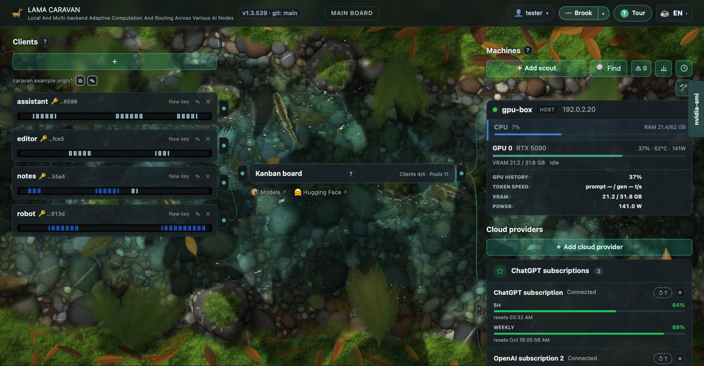
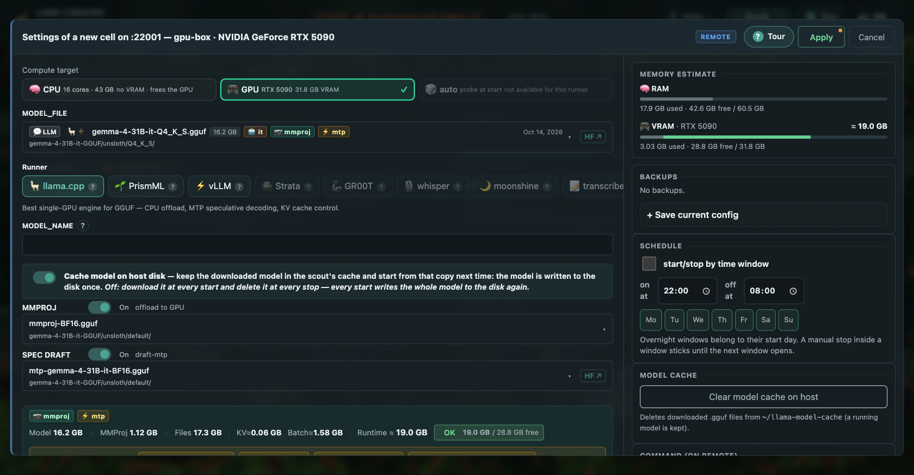
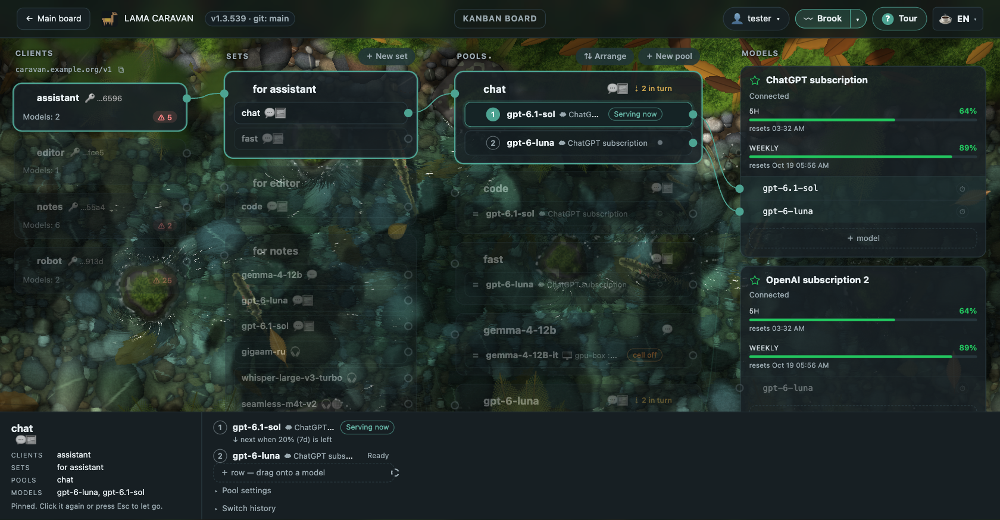
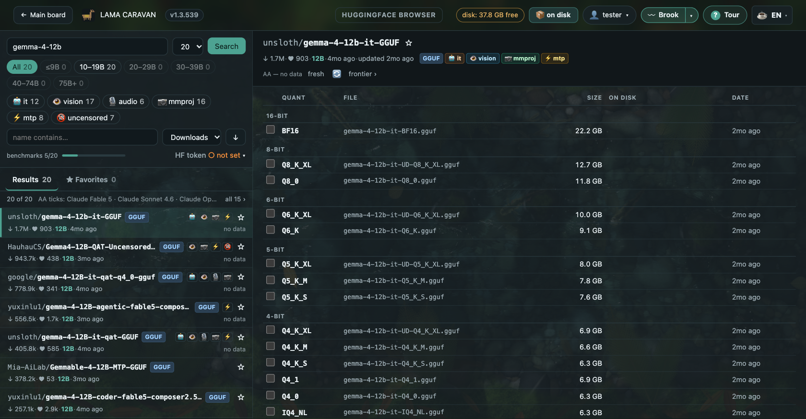

# LAMA CARAVAN

**L**ocal **A**nd **M**ulti-backend **A**daptive **C**omputation **A**nd **R**outing **A**cross **V**arious **A**I **N**odes.

Repository/service slug: `lama-caravan`.

Local control plane for LAMA CARAVAN: controller topology, proxy routing, and
per-host `llama.cpp` server cells.

The app is intentionally dependency-light: it uses Python standard library
HTTP handling and static HTML/CSS/JS.

## Why LAMA CARAVAN

The problem it solves: you have AI agents (OpenClaw, Hermes, anything speaking
the OpenAI API) burning tokens all day, a couple of machines with GPUs standing
mostly idle, and cloud subscriptions that are metered, rate-limited and see
your prompts. LAMA CARAVAN glues that into one system where **tokens are
processed wherever it makes sense right now** — locally when your hardware can
take it, in the cloud when it can't.

What that gives you in practice:

- **The OpenAI API, the way companies' gateways speak it.** A client gets one
  address and a key of its own, made with ＋ on the board, and one cable on the
  kanban leads it to a set of models: `model` in a request picks one of the
  set's pools by its name, as OpenAI's API picks a model, and `GET /v1/models`
  lists them with what each does. Errors come in OpenAI's shape — 401 for a
  key, 404 for a model the key's set has not (or while no cable leads the key
  to a set), 429 with `Retry-After` at a limit, 400 for work a model does not
  do — and say nothing of the providers, accounts and machines behind a pool.
  Any OpenAI SDK works as is: set `base_url` and `api_key`.
- **Stable endpoints, whatever runs behind them.** A client keeps its address
  and its key — and never needs reconfiguring again. Swap the model, move it to
  another machine, reroute to the cloud: the client doesn't notice. Agents of
  the older kind keep a fixed proxy port of their own, and may come in through
  the entry with that port's key instead.
- **Cloud models for ANY app, not just agents.** The caravan holds the
  keys/OAuth, picks the pool's row, meters the spend and logs the requests: a
  transcription tool, a translator overlay or an IDE plugin calls the entry with
  a key of its own and speaks to `gpt-…`/OpenRouter/Anthropic without owning a
  single credential. Every app comes in the same way: one address, its own key.
  Chat Completions and the Responses API (`/v1/responses`, what Codex CLI
  speaks) both work, on API-key and subscription rows alike.
- **Local ⇄ cloud routing you can draw.** On the kanban each client's cable
  leads to a set of models, the set's cables lead to pools — its models, picked
  by the request's `model` — and a pool is a list of rows — a subscription's
  model or a machine's cell, mixed as you like. The proxy tries the rows from the top and
  moves on at a limit, when a cell is off, while a cell is busy and a later row
  is free, or on an error before the first byte; a started stream is never
  cut. Changes hot-reload in ~2 s, no restarts.
- **Queues instead of timeouts — one GPU can serve many agents.** Requests
  line up with priorities and per-route limits, and the waiting ones are *held*
  rather than dropped. See [One GPU, many agents](#one-gpu-many-agents) below —
  it is the feature people are most surprised by.
- **Money and privacy.** Local tokens cost electricity; the cloud is used only
  where you routed it. Usage & spend statistics show tokens/requests/costs per
  agent and per backend, so the routing pays for itself visibly. Sensitive
  agents can be pinned to local-only routes — those prompts never leave the LAN.
- **Your whole zoo of hardware as one fleet — client GPUs included.** Put the
  [caravan-scout](https://github.com/thepr0metheus/caravan-scout) sidecar on a
  box whose GPU or CPU you want in the pool: its hardware and cells appear on
  the board, and you launch cells there remotely — **any of the eleven runners,
  on that host's own GPU or CPU**, models cached and shipped from the
  controller. Before starting you see a "will it fit" estimate against BOTH
  pools (RAM and VRAM) of that exact host; a running cell shows what it
  *actually* holds, measured per-process from `nvidia-smi` — on the
  controller and on scout hosts alike. A machine that only *runs* agents
  needs nothing installed — see [Deployment model](#deployment-model-a-scout-only-where-there-is-hardware-to-share).
- **Eleven runners, one lifecycle.** A cell is not just llama.cpp — pick the
  engine per cell, and they all share the same cards, health checks,
  start/stop/schedule machinery and memory math:
  - 🦙 **llama.cpp** — GGUF, CPU offload, MTP speculative decoding, KV-cache control
  - 🌱 **PrismML** — the PrismML llama.cpp fork for Bonsai GGUF (PQ2_0/PTQ1_0),
    in an isolated runtime installed on first start ([docs/prismml.md](docs/prismml.md))
  - ⚡ **vLLM** — safetensors (AWQ/GPTQ everywhere, NVFP4/FP8 on new GPUs),
    continuous batching; provisioned into its own venv on first start, with
    pinned version + one-click update/rollback
  - 🪨 **Strata** — Qwen3.8-Flash-Next (177B, GSQ-RCO ~2-bit GGUF) on one
    32 GB card, its experts streamed to the card; the engine is installed once
    with Strata's own `setup.sh`, and the model and its MTP draft layer come
    from the library like any GGUF
  - 🦾 **GR00T** — a robot policy (NVIDIA GR00T N1.7): camera frames, the
    robot's state and an instruction in, a chunk of actions out, at
    `POST /v1/robot/predict` — through the entry like any model
    ([docs/robot-policy-api.md](docs/robot-policy-api.md)). NVIDIA's own
    Isaac-GR00T runtime is installed once (`scripts/install-gr00t.sh`); the
    checkpoint and its Cosmos-Reason2 backbone come from the library
  - 🎙️ **whisper** — speech-to-text (faster-whisper); the model downloads
    itself, language is picked per request
  - 🌙 **moonshine** — CPU-only speech (Moonshine v2), both directions: STT
    that beats Whisper large-v3 accuracy on English at 250M params (also
    es/zh/ja/ko/vi/uk/ar — no Russian), and stock-voice TTS for 20 locales
    including Russian and Ukrainian — GPUs stay free for LLMs
  - 📝 **transcribe.cpp** — GGUF speech-to-text on the ggml runtime; one build
    runs GigaAM, Parakeet, Canary, Whisper and more, chosen by the file in the
    ordinary model picker. The best free **Russian** recognizer of the set —
    GigaAM-v3 near 8% WER against 21-25% for whisper large-v3, cased and
    punctuated, from a 260 MB file
  - 🌐 **Seamless** — speech to translated text in one model (SeamlessM4T v2):
    a Russian sentence in, an English transcript out
  - 🔄 **NLLB** — text translation (NLLB-200), the same card and lifecycle as
    every other cell
  - 🛠️ **Custom command** — any process that listens on `$PORT` becomes a
    managed cell: health-checked, logged, scheduled, restarted
- **Voice-clone TTS ships as command cells.** One bundled server, three
  engines picked per cell — `bash ~/run_tts.sh $PORT xtts|f5|cosyvoice` with
  `HEALTH_PATH /health` — cloning a voice from a short reference sample.
  CosyVoice2 is the engine whose weights allow commercial use (see
  [Model licences](#model-licences)); on Blackwell GPUs its venv needs the
  cu128 torch noted in [Tested versions](#tested-versions).
- **One compute-target switch.** Every cell picks **CPU / GPU / auto** with one
  control (options a runner can't do are disabled); a multi-GPU host fans out
  into per-card chips or a checklist, and llama.cpp gets the right
  device/split/threads flags written for it.
- **Models from HuggingFace in two clicks.** The built-in HF browser searches
  GGUF repos, shows quants with sizes and benchmark badges, downloads
  multi-part files straight into the controller's model directory.
- **You see everything.** A live topology board (cables light up with real
  traffic), per-request history with timings and error kinds, incident badges,
  GPU/CPU/token-speed monitors.
- **Nothing to install but Python.** Controller and agent are stdlib-only; no
  database server, no external services, Docker optional (see the quick start).
  State lives in plain JSON files (hot-reloadable, git-diffable, backed up by
  copying) plus one small embedded SQLite file for accounts/sessions — and
  systemd/launchd units on your own machines.

A concrete day with it: your coding agents hammer a local Qwen on the desktop
GPU all night on a schedule window; in the morning the schedule flips them to
a subscription provider while the GPU serves a bigger model for a research
agent; one agent with confidential data stays pinned to the local route; a
transcribe.cpp cell turns Russian speech into cased, punctuated text
(GigaAM-v3) while a CosyVoice cell answers in a cloned voice — a
voice-translation app on the LAN finds both by the engine self-ID their
`/health` publishes; and the spend chart shows what all of that would have
cost in cloud tokens.

The long version of that day — with the kanban that implements it — lives in
[docs/day-with-the-caravan.md](docs/day-with-the-caravan.md).

## Deployment model: a scout only where there is hardware to share

**[caravan-scout](https://github.com/thepr0metheus/caravan-scout) runs only on
machines that share hardware.** It is the sidecar of a box with a GPU (or
spare CPU) you want in the pool: it reports the machine — GPUs and what runs
on them, CPU/RAM, cells, the llama.cpp build — runs the cells the controller
configures, and keeps llama.cpp current.

Adding such a box takes two steps. On the box, from a clone of caravan-scout:
`./install.sh` — it installs what the machine needs, starts the scout and
prints its address and port. On the board: **Machines → ＋ Add scout**,
that address, Connect — the controller pairs the scout itself and hands it
the fleet token. From then on the box is a machine node, and its cells are
launched from there; its ✕ lets go again.

A machine that merely *runs agents* installs nothing. Each agent is a client
of the entry, made **on the board**: ＋ in the Clients column asks a name,
then shows its key once, and a cable on the kanban leads it to its pool. The agent calls the entry's
address with that key — that is the whole integration. Agents of the older kind
keep the proxy ports and records they have. A machine that does both shows up
twice: as a machine with its hardware and as its agents' client cards.

Why: fewer moving parts on machines that gain nothing from a sidecar, a
clearer support boundary ("what do I need to install?" — nothing, unless you
are sharing a GPU), and expectations that match what the feature does: the
scout is a hardware donor's sidecar, not a registry of everything that runs on
your network.

Since scout 2.0 (controller 1.3.353+) this is the whole architecture: a scout
says nothing about agents; client and agent cards are the operator's records,
and no report creates, rewrites or deletes them; a client's liveness is its
agents' traffic — idle after 12 hours without a request, the same on the
board and the kanban; a machine whose scout went silent is marked on its
node, and its ✕ lets go of the scout and removes the machine without touching any client.

## One GPU, many agents

<a id="one-gpu-many-agents"></a>

Three agents ask for 30 minutes of GPU each, at the same moment, and you own
one card.

Without a queue you get one answer and two casualties: the other agents sit
watching a silent socket, hit their own read timeout at a minute or two, and
give up with *"nobody is processing my tokens"*. The work is not slow — it is
**lost**, along with whatever chain of steps the agent was in the middle of.

With the caravan the same three finish in about 90 minutes, one after another,
and nobody drops:

```
agent A ──┐                    ┌── 0–30 min ── answer
agent B ──┼── one proxy queue ─┼── 30–60 min ─ answer
agent C ──┘   (per upstream)   └── 60–90 min ─ answer
              waiting agents stay connected
```

**How the waiting one survives.** A queued request is not a paused request: the
proxy answers immediately and keeps the stream alive, sending a keepalive frame
about every 20 s (configurable) until real tokens start flowing. The shape of
that frame is the whole trick, and it was found the hard way — clients reset
their read timeout
**only on chunks that carry actual token text**. SSE comments, role-only chunks
and `content: null` are ignored by them, so the obvious keepalives did nothing.
The caravan sends a `reasoning_content` delta instead: it counts as token
activity for the timer, but lands in the model's *thinking* channel, so it
never pollutes the visible answer. From the agent's side the request looks
exactly like a slow model that is already working.

**What bounds the wait.** Not a number we invented — the client's *own*
timeout, which the operator writes on its route (until 2026-09-24 the caravan
read it out of each agent's config), so the queue's thresholds scale against
the budget that client actually has (an hour is assumed while it is unknown). Chained queues share one absolute deadline, so a
second queue cannot hand out a fresh full budget after the first has already
spent part of it.

**What the queue is not.** It is not one global line: each request competes
only for the slots of *its own* upstream, and the slot count is read from that
server's real `--parallel`. Inside a server the order is plain arrival order —
priority buys no place in the line. What it buys is the right to *take a slot
back*: once a crowned route has waited its share of the budget (half, by
default) it can preempt a running request, while crowned requests that are
already running are never the victim. An agent that hangs up leaves the queue
immediately instead of holding a place. And a route with a spill edge does not
wait to the end — after a fraction of its budget (a fifth, by default) it walks
out to whatever that edge points at, a cloud model or another server. That edge
is a line you draw on the kanban.

**The honest part.** Everything still takes 90 minutes: the queue buys you
*completion instead of collapse*, not speed. And the keepalive only exists for
**streaming** requests — a non-streaming client sitting in the queue is still
just a client waiting on a silent socket, and survives only if its own timeout
is long enough. Details in [docs/backend-proxy.md](docs/backend-proxy.md).

## Quick start (Docker)

> **Docker is the evaluation path** — the fastest way to look around: one
> container with the admin UI and the proxy router, no models inside. The
> **primary, fully-featured deployment is the native systemd install**
> ([Install On the controller](#install-on-the-controller)). Neither runs a
> model itself: cells run on machines with a scout — the controller's own
> machine included, with a scout installed on it like on any other.

```bash
git clone https://github.com/thepr0metheus/lama-caravan.git
cd lama-caravan
TZ=<your/Zone> LLAMA_TOPOLOGY_SERVER_IP=<this-machine-LAN-IP> docker compose up -d --build
# open http://<this-machine>:7990
```

Both settings are required. `TZ` is the controller's time zone, e.g.
`Europe/Berlin`: every schedule runs by it. `LLAMA_TOPOLOGY_SERVER_IP` is the
address agents and scouts reach the controller at. Without them the container
does not start and says which one is missing.

Models are **not** served from inside the container (it has no systemd and, by
design, no GPU): on each GPU machine — the Docker host itself included — run
[caravan-scout](https://github.com/thepr0metheus/caravan-scout)'s
`./install.sh`, then enter the address it prints under **Machines → ＋ Add
scout**: the controller pairs the scout, and its cells appear on the board. All state lives in the `caravan-data` volume
(`/data`): config, accounts, token history, logs and downloaded models.

Notes:

- **Linux host recommended.** `network_mode: host` lets the proxy bind its
  per-agent ports on the fly; on Docker Desktop (macOS/Windows) enable its
  host-networking option or use the native install below.
- Liked it? For day-to-day fleet duty switch to the native install — the
  container is also fine long-term for a GPU-less controller box (NAS/VPS)
  where every model lives on scout hosts.
- Version chip: build with
  `CARAVAN_GIT_HEAD=$(git rev-parse --short HEAD) docker compose up -d --build`.

## Models directory layout

`/hf` downloads land as `<model-name>/<author>/<quant>/<file>.gguf`, e.g.
`gemma-4-12B-it-GGUF/bartowski/Q8_0/gemma-4-12B-it-Q8_0.gguf`. When adding
models by hand, any subfolder under the models dir is scanned — but following
the same layout keeps the model pickers, the disk-cleanup modal and
multi-part grouping tidy (parts `…-00001-of-00004.gguf` belong together).

## Screenshots

These are from 1.3.539 (2026-10-14), taken with the brook switched on: the water behind the pages is
the header's switch, which is off until you turn it on. The clients, the machine (`gpu-box`) and its
address are made up for the pictures — they are a stand's, not a real fleet's.

The main board, in three columns of one width — the entry's address and its clients on the left, each
with its recent requests as marks; the kanban's card in the middle, with how many clients have a set and
how many pools there are, and the links to the Models and Hugging Face pages under it; the machines at a
glance and the cloud providers on the right, their limit windows drawn once per subscription:



The cell editor: the compute target (CPU, a card, or auto), the model file with its kind and its
companions, the runner row (llama.cpp / PrismML / vLLM / Strata / GR00T / whisper / moonshine /
transcribe.cpp / Seamless / NLLB / custom), the memory estimate against BOTH pools of the host, the
mmproj and the MTP draft of a multimodal GGUF, the schedule window — and, below, every flag explained
and the exact command it will run:



The routing kanban — four columns joined by cables: the clients, the sets of models they see, the pools
and the models. A click on a card pins its path: here the pool "chat" with its client, its set and its
models lit, the rest stepped back, and its details in the strip under the columns — its rows as the
proxy says them, when it goes on to the next row, "＋ row", the pool's settings and its switch history.
A subscription's limits are drawn once on its card; a model's own two levels stand in its strip. With
nothing pointed at or pinned the strip is hidden:



The built-in HuggingFace GGUF browser:



## Requirements

| Component | Requirement |
|---|---|
| Controller OS | **Primary:** Linux with systemd (tested on Ubuntu 24.04; any systemd distro should work). **Evaluation:** any Docker host via the [Docker quick start](#quick-start-docker) — controller-only, cells then live on scout hosts |
| Python | **3.10+**, standard library only — no pip packages (tested on 3.12) |
| llama.cpp | a `llama-server` build **b400+** (needs `--chat-template-file`; see [Tested versions](#tested-versions)) |
| GPU serving | NVIDIA driver + `nvidia-smi` for telemetry; CUDA build of llama.cpp (CPU-only also works) |
| Scout hosts (share a GPU/CPU) | Linux (systemd --user) or macOS (launchd), Python 3.9+, [caravan-scout](https://github.com/thepr0metheus/caravan-scout) — 2.24+ on the controller's own machine (2.25+ to say why it lists no card): the controller powers it, reads and updates its GPU driver and reads its cards and processes through that scout |
| Agent-only machines | nothing to install — the agent calls the entry with its key (an agent of the older kind, its proxy port) |
| Browser | any modern browser — native ES modules, no build step |
| Storage | plain JSON files + an embedded SQLite file (accounts/sessions); no database server required |

## Tested versions

The exact versions the development fleet runs — re-verified and updated here
whenever a component is upgraded (last verified: **2026-10-13**):

| Component | Verified version |
|---|---|
| llama.cpp | release `b10357` (commit `689e227db`, built 2026-08-11), CUDA build — updated through the GUI Update-build button; verified live with Muse Glimmer 30B (vision+video modalities detected, ~70 t/s decode on the RTX 5090). The Linux client still runs `b9947` until its own ⇪ chip is pressed |
| CUDA toolkit | 12.6 |
| NVIDIA driver | 610.57.04 open kernel module (controller, 2026-09-26), 580.159 (client). Under Secure Boot the driver metapackage is not enough: the Canonical-signed `linux-modules-nvidia-610-open-generic-hwe-24.04` must come with it, and no DKMS build may shadow it — `updates/dkms/` outranks `kernel/` in the module search path. A kernel from the security pocket arrives before its signed modules, whose driver lives in the updates pocket: that kernel boots without the GPU. The DKMS from NVIDIA's CUDA repository (3.4.x) also fails a kernel's setup when a signed module of the same version is already there; `BUILD_EXCLUSIVE_KERNEL="^$"` in `/etc/dkms/nvidia.conf` stops it building nvidia at all, which costs nothing where Secure Boot rejects its builds anyway |
| GPUs | RTX 5090 (Blackwell `sm_120`), RTX 3090 (`sm_86`) |
| OS | Ubuntu 24.04.4 LTS (controller, kernel 7.0.0-34 + Linux client), macOS 26.5 (Mac client) |
| Python | 3.12.3 (controller, Linux client); the macOS scout runs on stock 3.9.6 |
| systemd | 255 (Ubuntu 24.04) |
| Docker (container mode) | 29.1 |
| faster-whisper | 1.2.1 (CTranslate2 4.8.0, cuDNN 9.26 from the `nvidia-cudnn-cu12` wheel) — whisper command cells; a transcription verified on the Linux host 2026-09-24 |
| vLLM | 0.30.0, pinned provisioning — on the controller's machine since 2026-10-05, installed through System (the scout's update job; 0.24.0 stays in its rollback history) because 0.24.0 carried 28 known vulnerabilities (osv.dev); a cell (`:22026`, model folder read from the NAS library) last verified on 0.24.0 2026-09-25 |
| Ollama | 0.34.4, next to the cells on the controller's machine — installed in the user's home from the official release (no sudo), listening on 127.0.0.1, its server started and stopped from the board, a model downloaded and deleted from the board (verified 2026-09-25); its scout finds it, the board names the VRAM its runner holds and lists its models, verified 2026-09-25; two models loaded at once, and loading and unloading them from the board (a model loaded from the board stays until unloaded), verified 2026-09-25. Its runner is a bundled `llama-server` of its own (`lib/ollama/llama-server`): the scout never takes it for a cell — a different binary, without the scout's mark |
| LM Studio | headless `llmster` 0.0.25 (LM Studio without its window; runtime `llama.cpp-linux-x86_64-nvidia-cuda12-avx2` 2.45.0), next to the cells on the controller's machine — installed in the user's home by the official installer without touching PATH, listening on 127.0.0.1:1234; its scout reads the v1 API (`/api/v1/models`), the board lists its models, their windows and the memory it holds, and loads and unloads them, verified 2026-09-25; a load with an idle limit goes through its `lms load --ttl`, and its own `--estimate-only` says what a load needs, verified 2026-09-25 |
| caravan-scout | 2.31.0 on the GPU machine (2026-10-13) — it runs every cell there (one trial start per runner); since 2.31 it brings every part of a split GGUF and a command cell's other model files through the controller, starts a command cell in the background, keeps a command cell's models as the cell's cache switch says, and names the processes a cell's server started (Strata's engine); installed with `./install.sh` and added from the board (Machines → ＋ Add scout); knows its machine only, touches only the processes it started and the files it downloaded, reads a model in place where it has the controller's file, starts its autostart cells when the machine boots, brings a crashed cell back, runs each cell under the memory limits the controller's cells had, says when a fresh llama.cpp build crashes them, refuses a vLLM start its card cannot hold, reports a vLLM cell's queue and speed, updates and rolls back the vLLM in its machine's venv, samples the machine every second for the board's charts, keeps its id when the machine is renamed, names the address the network knows the machine by even when paired over loopback, says which of a running cell's files changed on disk after it started, and names the model engines next to its cells (Ollama, LM Studio; verified against a stand-in engine and the real ones), unloads their models when the board asks, starts and stops the engines' servers themselves and starts them again when the machine boots, downloads models into them and deletes Ollama's, who its firewall lets reach them, the processes that hold its cards, and what the machine's next reboot does to its NVIDIA card: Secure Boot as the firmware says it, the kernel that boots next and who signed its module, the driver loaded and the one installed; for the controller it reads its machine's driver packages and installs the one the controller picks, lists the busiest processes and takes the nvidia-smi and btop snapshots (2.24.0, verified 2026-10-07), and says in nvidia-smi's words why it lists no card (2.25.0) |
| moonshine-voice | 0.0.69 — moonshine STT command cells (CPU-only) |
| Isaac-GR00T | commit `d2b7e75` with torch 2.9.0+cu128, transformers 4.57.3 and flash-attn 2.8.3 (its own `uv.lock`, uv 0.13.0) — GR00T cells; GR00T N1.7 3B (revision `2fc962b`) with Cosmos-Reason2-2B (revision `9ce19a1`) on the RTX 5090: one prediction of 40 actions in about 61 ms, 7.0 GB of VRAM, the DROID sample answered through the cell's HTTP API, verified 2026-10-13 |
| Strata | v0.1.42 (commit `61b3fb5`), engine built on the machine with nvcc 13.2.86 (CUDA 13.2.2 — nvcc 13.2.78 miscompiles `sm_120`, Strata issues #892, #968) — Strata cells; Qwen3.8-Flash-Next GSQ-RCO IQ2_XS on the RTX 5090: 159–192 tokens/s with the MTP draft layer, verified 2026-10-13 |
| transcribe.cpp | 0.2.0 (commit `b6a6aca`, 2026-07-22), CUDA build — transcribe cells; verified with `gigaam-v3-e2e-rnnt-Q8_0.gguf` |
| CosyVoice (TTS cells) | upstream checkout + torch **2.7.1+cu128** in the engine venv — the cu128 wheels carry `sm_75…sm_120`, so the same cell runs on the RTX 3090 and the RTX 5090; CosyVoice's own pin (2.3.1+cu121) stops at `sm_90` and dies on Blackwell with "no kernel image" |

> The build number `llama-server --version` prints counts commits in the *local
> clone* — a shallow clone undercounts vs upstream `bNNNN` tags, so the commit
> hash is what identifies the build (the topology UI compares commits for the
> same reason). The vLLM runner provisions PINNED (`VLLM_DEFAULT_VERSION`,
> currently 0.30.0; `VLLM_VERSION` env overrides) and is updated/rolled back
> from System → llama.cpp — pip installs are versioned by PyPI itself, so no
> local snapshots are needed.
>
> Field note (2026-07-10): during the `b9947` rollout, `llama_decode` crashed
> with `CUDA error: invalid argument` on the MoE + MTP model — root cause was
> NOT the release but a **stale build dir**: it had been *configured* under
> CUDA 12.6 and incrementally rebuilt with nvcc 13.2, mixing objects with
> different `cudaDeviceProp` layouts (the same franken-build that caused the
> June smpbo incident). `install-llama.sh` now wipes `build/` automatically
> when the cached compiler version doesn't match the live `nvcc`. Two lessons:
> pin a `bNNNN` tag and verify one cell before restarting the rest, and never
> trust an incremental CUDA build across toolkit upgrades.

## Documentation

| Doc | Covers |
|---|---|
| [docs/architecture.md](docs/architecture.md) | Components, data flow, the file contract between the daemons, deployment topology |
| [docs/backend-admin.md](docs/backend-admin.md) | `caravan/admin/` module reference (the admin server) |
| [docs/backend-proxy.md](docs/backend-proxy.md) | `caravan/proxy/` module reference + the request lifecycle |
| [docs/frontend.md](docs/frontend.md) | `static/js/` ES-module reference, state model, render/polling pipeline |
| [docs/http-api.md](docs/http-api.md) | Every HTTP endpoint of the admin and the proxy surface |
| [docs/operations.md](docs/operations.md) | Runbook: services, deploy, rollback, backups, the entry with keys and its clients, local dev, quirks |
| [docs/pools.md](docs/pools.md) | Pools of rows: the kanban, the levels on a model, the next row, what a client sees at a limit |
| [docs/robot-policy-api.md](docs/robot-policy-api.md) | A robot policy (GR00T) through the entry: `POST /v1/robot/predict`, the request, the answer, the errors, measured latency |
| [docs/day-with-the-caravan.md](docs/day-with-the-caravan.md) | A worked example: one day of hybrid local/cloud routing and the kanban behind it |
| [docs/security.md](docs/security.md) | Accounts/sessions (SQLite), the fleet token for scouts, what stays open |
| [docs/testability.md](docs/testability.md) | The E2E contract: `data-t` hooks as public API, page identity/readiness flags, landmark names — what an external test suite may rely on |

The controller's own settings — the models directory and the defaults a new
cell starts from — live in the marked config block of this script (see
[Safety Model](#safety-model)):

```text
~/llama.cpp/start-server.sh
```

Server cells run on machines with a scout — the controller's own machine
included — from the cell's structured config, which the controller keeps and
hands to the machine's scout on every start.

## Runtime Layout

On the controller the admin service is `lama-caravan.service` and the proxy
daemon is `lama-caravan-proxies.service` (templates in `systemd/`). Each
machine's scout starts that machine's cells. An older install may still have
the legacy single server `llamacpp-current.service` (see
[Legacy single server](#legacy-single-server)).

```text
~/.config/systemd/user/lama-caravan.service
  -> ~/lama-caravan/.venv/bin/python app.py

~/.config/systemd/user/lama-caravan-proxies.service
  -> ~/lama-caravan/.venv/bin/python agent-proxies.py

~/.config/systemd/user/llamacpp-current.service   (legacy, if present)
  -> ~/llama.cpp/start-server.sh
     -> ~/llama.cpp/build/bin/llama-server
```

For boot-time autostart without waiting for an interactive SSH or
desktop session, enable linger for your user and install the user
services. Do not also keep a crontab `@reboot` launcher for this admin: two
launchers will fight for port `7990`.

```text
loginctl enable-linger $USER
```

Default URL:

```text
http://<controller-ip>:7990
```

## Code Layout

`app.py` and `agent-proxies.py` are thin launchers (systemd entry points and
the load target for `scripts/test_queue_node.py`); the code lives in the
`caravan/` package:

```text
caravan/
├── common/   shared stdlib helpers: errors, procs, fsio (atomic writes),
│             fetch, jsonx, ttl_cache
├── admin/    the admin server (app.py): paths, state, config_builder, launch,
│             models, systemd_ctl, llama_metrics, hf, downloads, benchmarks,
│             terminal, router_dsl, proxies_config, cloud, token_history,
│             proxy_stats, monitoring, openclaw, oauth, cloud_api, pricing,
│             telemetry, server_cells, fleet_clients, topology, proxy_ops,
│             backups, status, cell_ops, routes (HTTP tables + Handler), main
└── proxy/    the proxy daemon (agent-proxies.py): paths, runtime (shared
              mutable state), config, events, capacity, graph (router DAG),
              state, cloud_auth, translate, summarize, queue_admission,
              handler, listeners, main
```

Import layering is strict and cycle-free: `common` ← `paths` ← `state` ←
domain modules ← aggregators (`topology`, `status`) ← ops/`routes` ← `main`.
Rebindable module globals live in the same module as every function that
rebinds them.

## Deployment Rule

Source changes are deployed through git only:

```text
local commit -> push to your remote -> git pull on the controller/scout hosts
```

Do not deploy project code by direct `scp` or hand-copying files, except for an
explicit emergency recovery. Generated runtime files under `var/` are local host
state and are not the source deployment path.

`scripts/deploy.sh` wraps the whole flow in one command — refuse-if-dirty,
push, pull on the controller, byte-compile, restart the admin and — only when
its own code changed — the proxy, then **verify `/health` reports the exact
version and commit that were shipped**:

```sh
CARAVAN_DEPLOY_HOST=<controller-ssh-host> bash scripts/deploy.sh
# checkout path via CARAVAN_DEPLOY_PATH (default ~/projects/lama-caravan);
# --no-restart for static-only changes
```

## Features

**Cells & runners**

- Eleven runners per cell — 🦙 llama.cpp, 🌱 PrismML, ⚡ vLLM, 🪨 Strata, 🦾 GR00T,
  🎙️ whisper, 🌙 moonshine, 📝 transcribe.cpp, 🌐 Seamless, 🔄 NLLB, 🛠️ custom command — same
  lifecycle, health checks and cards for all of them.
- One CPU/GPU/auto compute-target control for every runner; unavailable options
  are disabled per engine. A multi-GPU host picks cards with chips (or a
  checklist beyond four), and llama.cpp gets the matching
  device/split/threads flags written for it.
- Memory estimate against BOTH pools (RAM and VRAM) of the target host, each
  engine by its own rule: llama.cpp sums its files, KV cache and batch, vLLM
  reserves its share of the card, Strata takes the card's free VRAM and needs
  6 GB of it, GR00T holds the 7.5 GB its policy was measured at. A running cell shows its **measured** usage (per-process
  `nvidia-smi`) carved out of the used bar instead of a double-counted estimate.
- Cells run on the controller or on any scout host — the GPUs and CPUs of
  scout hosts are first-class; models are cached and shipped from the
  controller.
- Reserve globally numbered cells from port `22001` (CARAVAN_CELL_BASE_PORT; proxies get
  their own block at `23001+` via CARAVAN_PROXY_BASE_PORT) — the controller's own web
  port (`LLAMACPP_ADMIN_PORT`, default `7990`) sits inside that numbering and is
  held out of the pool automatically; cells are scout-managed processes on
  the machines with a scout, the controller's own machine included (they
  survive scout restarts).
- Per-cell schedule windows (start/stop by time of day and weekday), autostart,
  a port picker with a fleet-wide grid, and port swap between stopped cells.
- llama.cpp lifecycle: fleet-wide update button, build archive with informed
  one-click restore, a sticky crash watchdog with a server-dismissed banner,
  and a franken-build guard (stale CUDA build dirs are wiped automatically).
- vLLM lifecycle: pinned provisioning into its own venv on first start,
  update/rollback driven by pip's own version history.
- A running cell is ringed by an animated border comet — on its board card AND
  around its config window, colored by compute target (CPU cells blue).
- **A sick cell cannot look healthy.** A cell whose own health endpoint
  answers with an error shows as broken — 💔 plus the engine's own diagnosis
  on the card — instead of a green RUNNING: a live process around a dead
  engine never masquerades as fine. A cell running an older copy of its
  server than the controller ships wears an ⇪ old-server chip (every speech
  cell reports a source hash on `/health`).
- Hosts can be rebooted — or powered off, behind a type-the-hostname
  confirmation — right from the board. Poweroff warns you first: the board
  can turn a machine off, not back on.
- The kanban (`/kanban`) is four columns joined by cables — the clients, their
  sets of models, the pools and the models — and a strip under them that says
  the details of the card the pointer is on or a click pinned (hidden while
  there is none). A client's one cable leads to a set, the set's cables lead to
  pools, and a pool is a list of rows — subscriptions' models and cells —
  tried from the top. The main board shows, in three columns of one width,
  the clients, the kanban's card (how many clients have a set, how many pools
  there are) with links to the Models and Hugging Face pages, and the machines
  with the cloud providers.
- Each machine shows its load at a glance under Machines — CPU and RAM, each
  GPU and their history; a click on its card shows the machine in a window of
  its own (`/machine?host=<id>`) with its servers, engines, models and cells.
- Cloud providers stand under the machines, each a block of its accounts:
  **＋ Add cloud provider** puts an empty one there, and its **＋** adds a
  ChatGPT subscription (straight to the sign-in code) or an API key. A
  subscription's row shows its limit windows and a small **↺ N** for its
  saved resets; ⚙ opens everything else about the account.

**Routing & proxies**

- One entry with keys: the OpenAI API on one address, a key per client (shown
  once, a new one replaces it), the set of models its cable leads to (`model`
  picks the pool), `/v1/models`, errors in OpenAI's shape; a robot policy
  answers `POST /v1/robot/predict`
  ([docs/robot-policy-api.md](docs/robot-policy-api.md)). Stable proxy ports
  for agents of the older kind, which still go through their router's graph as
  it was saved; the kanban no longer draws that graph.
- Pools of rows: a pool is a list of rows, each a subscription's model or a
  machine's cell (two ChatGPT subscriptions, then a local cell). The proxy
  takes the first row that fits and moves on at a limit — the model's own two
  levels on the 5H and weekly windows (below the switch it gives way to the
  next rows, at the stop it does not serve), 429, 402, 401 — when a cell is
  off, while a cell is busy and a later row is free, or on an error before the
  first byte. A pool has no port of its own: every client comes in through the
  entry with its key.
- Route truth-telling: a route is *confirmed* by real traffic in the proxy log
  and *unverified* when nothing can vouch for it — two visually distinct
  states, so silence never masquerades as health.
- A client's activity is on the board: its card lights while its request runs
  and shows its recent requests, its cable lights to the kanban's card, and the
  kanban's cables to the machines and the cloud providers its pools lead to
  light where a request runs.
- Cables on the board and kanban fan into parallel lanes instead of piling
  into one trunk; a cable that cannot be drawn says so in the console instead
  of vanishing.

**Observability**

- Live topology board: cables light with real traffic, per-output activity,
  GPU/CPU/RAM bars per host, token-speed and power charts, incident badges.
- Request History with per-request timings, stream stats, error kinds, rescue
  badges; request-log diagnostics API
  (`/api/agent-proxy-logs?port=&errors=1&slim=1`) for debugging routes without
  ssh.
- Usage & spend statistics per agent and per backend; `/metrics` for
  Prometheus (clients, cells, GPU, routes).
- System page: controller services, cells, git/python versions, models-disk
  usage with a cleanup modal; a models page for the library on disk.
- Orphaned cells — running units the config no longer knows about — surface
  as a red ☠ strip with a Stop button, and their ports stay guarded; a
  machine whose scout went silent says so on its node, and its ✕ removes the
  machine without touching any client.

**Platform**

- Web UI in **20 languages** with a CI guard that keeps every key translated.
- Sign-in: SQLite accounts + sessions, a fleet token for the scouts. A fresh
  install asks for its first account at `/setup` before anything else
  (see [docs/security.md](docs/security.md)).
- Built-in onboarding tours (the floating `?` button) on the board, the kanban
  and the HF browser; with the editor open the same button explains every
  llama.cpp config field.
- Light, dark, and black LLM-focused themes.
- A living brook behind every page, if you want one: water seen from above, trout, leaves and a
  calm sound made in the browser. One header switch turns it on and off everywhere; it is off until
  you turn it on, and the browser remembers the choice.
- **Legible without sight, testable by contract.** Landmark regions, machine
  cards as named groups, one `<h1>` per page, unique accessible names on
  every repeated control — announced in the interface language. The same
  structure is published as a testability contract
  ([docs/testability.md](docs/testability.md)): `data-t` hooks, a page
  identity + readiness flag on `<body>`, and an open `/health` — an external
  test suite can drive the UI through exactly what a screen reader sees.
- Comfortable to watch from several browsers at once: HTTP/1.1 keep-alive,
  gzip (~10× on the big payloads), deep accept queues, incremental monitor
  deltas, per-language dictionaries loaded on demand.
- Docker controller-only mode for evaluation; stdlib-only Python everywhere.

## Speculative decoding

Speculative decoding is set per cell, in the cell editor, with upstream
llama.cpp's own flags. Picking the model fills it in: a draft or MTP-head GGUF
stored next to the model becomes `SPEC_DRAFT_MODEL_FILE` (`--model-draft`), and
the draft depth follows the block size in that file's header when it has one.
The type (`SPEC_TYPE`, `--spec-type`) comes from the first word of the file's
name: `mtp-…` is `draft-mtp`, `dflash-…` is `draft-dflash`, `dspark-…` is
`draft-dspark`, `eagle3-…` is `draft-eagle3`. A file in a folder named `mtp`
(the older layout, `<model>/mtp/<file>`) is `draft-mtp` too, and any other file
is `draft-simple`. A cell whose type is left empty is launched by the same rule.
Set the type by hand for a file named otherwise. A model with an MTP head inside
it gets `draft-mtp` and no file. The **Speculation** tab holds the rest: the
type, the draft's GPU layers, its depth and its KV-cache types. The five
`ngram-*` types draft from the prompt itself: no file, no extra VRAM.

A Gemma 4 cell with its MTP head, as in `scripts/start-server.sh`:

```text
SPEC_TYPE="draft-mtp"
SPEC_DRAFT_MODEL_FILE="gemma-4-31b-it/mtp/gemma-4-31B-it-MTP-Q8_0.gguf"
```

starts `llama-server` with `--spec-type draft-mtp --model-draft <that file>
--gpu-layers-draft 999`. An embeddings cell never gets these flags.

Until 2026-06-04 Gemma 4's MTP head needed a fork of llama.cpp (`--mtp-head`,
the `atomic-llama-cpp-turboquant` runtime); upstream llama.cpp does it with the
flags above.

## Legacy single server

An older install may still run one llama.cpp server as the systemd user unit
`llamacpp-current.service`. The page no longer edits it. What is left:

- System → Diagnostics shows the unit's state and PID and whether its HTTP port
  answers. While the unit is off, these rows fold away under a details line:
  off is the normal state when cells do the serving.
- **Repair user service** reloads systemd's user units and restarts the unit.

Its editor left the page in 1.3.365 (2026-09-25): the `start-server.sh` form
with its backups and revert, the Gemma 4 text and vision mode buttons, and the
runtime panels. A cell is edited in its machine's cell editor; the controller's
own settings are saved as [Safety Model](#safety-model) describes.

## Model licences

The caravan is MIT, but **the models and engines it runs are not** — and their
terms follow the weights, not this repository. Nothing here re-licenses them,
so check what a cell actually runs before putting it in front of paying users:

| what a cell runs | licence |
|---|---|
| llama.cpp, faster-whisper, CTranslate2, F5-TTS *(code)* | MIT |
| vLLM, CosyVoice2 | Apache-2.0 |
| Strata | MIT |
| Isaac-GR00T *(the GR00T runtime's code)* | Apache-2.0 |
| GR00T N1.7 and Cosmos-Reason2 weights | NVIDIA Open Model License |
| Qwen3.8-Flash-Next GSQ-RCO weights | Apache-2.0 |
| coqui-tts *(the XTTS engine's code)* | MPL-2.0 |
| Moonshine EN model | MIT |
| Moonshine non-EN models | Moonshine Community Licence — free under $1M/yr revenue, registration + attribution |
| **SeamlessM4T v2 weights** | **CC-BY-NC-4.0 — non-commercial** |
| **NLLB-200 weights** | **CC-BY-NC-4.0 — non-commercial** |
| **XTTS-v2 model** | **Coqui Public Model Licence — non-commercial** |
| **F5-TTS base model** | **trained on CC-BY-NC data — non-commercial in practice** |
| GGUF models you download | whatever their publisher says (Llama, Qwen and Gemma each differ) |

The rows in bold are the ones that surprise people: the *engine* is open
source while the *weights* it loads are not free for commercial use. The engine
picker in the cell editor repeats this next to each choice, because a dropdown
is where the decision actually gets made. CosyVoice2 is the voice-clone engine
without that restriction.

## Safety Model

The controller's own config — the models directory and the defaults every new
cell starts from — is kept between:

```bash
# BEGIN LLAMA CONFIG
# END LLAMA CONFIG
```

in `~/llama.cpp/start-server.sh` (`config/start-server.sh` on the data volume in
the Docker image). Saving it rewrites that script whole, from the command
builder that starts the cells, and keeps no backup copy: export the settings
file first (System page) when a change is worth being able to take back — it
carries the script as `controller-config`, and an import keeps a copy of what it
replaces.

Saving it deletes no model.

## API

The full endpoint reference (the admin surface and the proxy surface) lives in
[docs/http-api.md](docs/http-api.md). A few that matter most:

- `GET /api/state` — the controller's own state: its config, models, services, hardware, llama.cpp.
- `GET /api/topology` — the whole board: hosts, GPUs, cells, proxy routes,
  routers, clients, assignments.
- `GET /api/agent-proxy-logs?port=&errors=1&slim=1` — per-request diagnostics
  for a route (timings, error kinds) without touching ssh.
- `POST /api/agent-proxy-entry` — open, move or close the entry for keys.
- `POST /api/consumers/create` — a client of the entry: a name; answers its
  key, this once. `POST /api/consumers/set` cables it to a set of models;
  `POST /api/sets/create`, `/api/sets/add-pool` and the other `/api/sets/*`
  doors make the sets and fill them with pools.
- `POST /api/topology/client-heartbeat` — heartbeat receiver for
  `caravan-scout` on the hosts that share hardware.
- `GET /metrics` — Prometheus metrics: clients, cells, GPU, routes.

## Topology GUI

The web UI is six pages, each at one canonical address (the old synonyms
redirect: `/` → `/board`, `/router` → `/kanban`):

| page | what it is |
|---|---|
| `/board` | the main board in three columns: the entry's address and its clients with their recent requests, agents of the older kind; the kanban's card with its counts and the links to Models and Hugging Face; the machines and the cloud providers at a glance — cables lit by traffic between them |
| `/machine?host=<id>` | one machine in a window of its own: its servers, engines, models and cells with lifecycle controls, GPU telemetry |
| `/kanban` | the kanban: clients, sets, pools and models in four columns joined by cables, and under them a strip with the details of the card under the pointer |
| `/models` | the GGUF library on disk: sizes, which cells use what, cleanup |
| `/system` | controller services, llama.cpp builds, accounts, diagnostics |
| `/hf` | the HuggingFace GGUF browser |

`/login` and `/setup` are separate pages — a fresh controller bounces to the
first-run wizard, an enabled one to sign-in.

Topology state is stored in the admin state file:

```text
~/.local/state/llamacpp-easy-admin/admin.json
```

Hosts that share hardware run `caravan-scout` and heartbeat into:

```text
POST http://<controller-ip>:7990/api/topology/client-heartbeat
```

The graph model is:

```text
client (its key) -> the entry -> its set -> the pool `model` names -> a row: a subscription's model | a machine's cell -> GPU(s)
```

A client of the entry is served by the pools of the set its cable on the
kanban leads to, the one its request's `model` names; a model the set has not,
or a key with no cable yet, is 404. An agent of the older kind comes in
by its own proxy port (or by the entry, with that port's key) and goes through
its router's graph, as it was saved. Clients and agents are owned by the admin server and
made on the board. Scouts report machines — never clients or agents — and run
the cells the controller configures.

## Install llama.cpp

Run the install script on the target host (builds the CUDA server on
Linux/NVIDIA hosts and exits harmlessly elsewhere):

```sh
cd ~/lama-caravan
bash scripts/install-llama.sh
```

This will:
- Fetch the latest llama.cpp release tag from GitHub
- Clone or update `~/llama.cpp`
- Build `llama-server` with CUDA (auto-detects GPU architectures)
- Provision the whisper STT server at the end (non-fatal if it can't)

Optional flags:

```sh
# Pin a specific release
bash scripts/install-llama.sh --llama-tag b9101

# Force rebuild even if the binary already exists
bash scripts/install-llama.sh --force

# Skip service restart
bash scripts/install-llama.sh --no-restart
```

To update llama.cpp to the latest release on an already-built host:

```sh
bash scripts/install-llama.sh --force
```

### Blackwell (RTX 5090 / `sm_120`) notes

**smpbo workaround — now probe-gated (historical for most stacks).** In June
2026, on a Blackwell host, `llama-server` crashed on inference with `SOFT_MAX
failed: CUDA error: invalid argument`: `cudaDeviceProp.sharedMemPerBlockOptin`
read a garbage ~4 GiB value that the driver rejected in
`cudaFuncSetAttribute`. The corruption turned out to be specific to
early/mismatched Blackwell driver+toolkit combinations, not a general llama.cpp
bug — upstream closed the equivalent fix PRs
([#22338](https://github.com/ggml-org/llama.cpp/pull/22338),
[#23766](https://github.com/ggml-org/llama.cpp/pull/23766),
[#24991](https://github.com/ggml-org/llama.cpp/pull/24991)) as unreproducible
on current stacks, and our own re-verification on 2026-07-10 (RTX 5090, driver
595.71, CUDA 13.2) confirmed a clean **unpatched** build reads the value
correctly and serves inference without the crash.

`install-llama.sh` therefore no longer patches unconditionally: on `sm_120`
hosts it compiles a 20-line probe comparing the struct field against the
`cudaDeviceGetAttribute` API. Only if the probe reads garbage (the incident
condition) does it apply the single-file workaround; on healthy stacks the
clone stays pristine, which keeps git-based updates fast-forward clean. No
change is ever needed in `caravan-scout` — it runs no CUDA code.

**Quant caveat (still current):** `IQ4_NL` (and likely other `IQ*` quants)
produce garbage output on the Blackwell GPU backend — the `sm_120` dequant
kernel is broken (confirmed: works on CPU, garbles on GPU regardless of build
flags). This is independent of the smpbo story. **Use a K-quant** (`Q4_K_M`,
`Q5_K_XL`, `Q6_K`) on Blackwell hosts.

Full incident write-up and the retirement verification:
[`docs/postmortem-blackwell-soft-max-crash.md`](docs/postmortem-blackwell-soft-max-crash.md).

## Install the speech engines (STT & TTS)

Every speech runner is provisioned by its own script — same split as llama.cpp:
the script installs, the cell only runs. All are idempotent, and all drop the
cell server + launcher into `$HOME` (`~/<runner>_server.py`, `~/run_<runner>.sh`).

| runner | install | cell `COMMAND` | model comes from |
|---|---|---|---|
| 🎙️ whisper (STT) | `scripts/install-whisper.sh` — also auto-run by `install-llama.sh` | `bash ~/run_whisper.sh $PORT large-v3` | self-downloads on first start (progress shows as a % bar on the card) |
| 🌙 moonshine (STT+TTS) | `scripts/install-moonshine.sh` | `bash ~/run_moonshine.sh $PORT en` | self-downloads per language |
| 📝 transcribe.cpp (STT) | `scripts/install-transcribe.sh` | `bash ~/run_transcribe.sh $PORT <model>.gguf` | the ordinary **MODEL_FILE picker** — ASR GGUFs download through the same `/hf` browser as LLMs |
| 🌐 seamless (speech→translated text) | `scripts/install-seamless.sh` | `bash ~/run_seamless.sh $PORT <model dir> rus` | the **MODEL_FILE picker** — download `facebook/seamless-m4t-v2-large` (FP32 safetensors artifact) from `/hf`. Weights are **CC-BY-NC-4.0**: non-commercial. Outputs the target language only, with no source transcript |
| 🔄 NLLB (text translation) | none — shares the seamless venv | `bash ~/run_translate.sh $PORT <repo id> eng_Latn rus_Cyrl` | the model is an **HF repo id** and downloads itself (2.5 GB for the distilled 600M), so nothing goes through `/hf`. Weights are **CC-BY-NC-4.0**. Serves `POST /v1/translate` — not a chat model |
| 🗣️ TTS (voice clone) | `scripts/install-tts.sh` | `bash ~/run_tts.sh $PORT xtts\|f5\|cosyvoice` | each engine self-installs its venv + weights on first start |

Every cell sets `HEALTH_PATH: /health`. What each `/health` answers is a small
contract: `engine`, `model` and a `source` hash while ready, or a
`downloading/loading` progress body while starting — it is how the board draws
honest progress bars, how the ⇪ stale-server chip works, and how other LAN
apps discover a speech cell without configuration.

Worth knowing before the first start:

- **Platforms.** whisper and TTS are Linux/NVIDIA-only (the scripts exit
  cleanly elsewhere); moonshine runs anywhere on CPU;
  **transcribe.cpp also builds on macOS** (Metal) — it needs `cmake` and
  `git`, and wants OpenBLAS (without it the decoder is 10–15× slower).
- **First start vs prewarm.** The venvs self-install on a cell's first start —
  for TTS that is tens of gigabytes and 10–20 minutes. To pay that cost at
  install time instead:
  `bash scripts/install-tts.sh --prewarm "xtts f5 cosyvoice"` (same idea:
  `install-moonshine.sh --prewarm "en"`).
- **ffmpeg for TTS.** XTTS synthesis needs the system ffmpeg libraries
  (torchcodec dlopens them); `install-tts.sh` apt-installs ffmpeg when it can
  `sudo`, and warns when it can't.
- **Blackwell GPUs.** CosyVoice's own requirements pin a torch whose kernels
  stop at `sm_90`; the launcher installs **torch 2.7.1+cu128** first
  (`sm_75…sm_120` — one venv serves an RTX 3090 and an RTX 5090 alike). See
  [Tested versions](#tested-versions).
- **Long recordings.** transcribe.cpp reads the model's audio window from the
  GGUF (25 s for GigaAM-v3) and auto-chunks longer input at the quietest
  moment; responses carry a `chunks` count so you can tell it happened.
- **Concurrency.** A speech cell runs one inference at a time (one resident
  session behind a lock — the engines crash on parallel inference, verified,
  not assumed); requests queue at the socket (depth 64). To parallelize, run
  a second cell of the same engine on another port and split traffic in the
  kanban.

## Install On the controller

**This is the primary deployment.** The [Docker quick start](#quick-start-docker)
above is for evaluation (or a GPU-less controller box); a real fleet controller
runs native under systemd. It runs no cells itself: to put the controller's
own GPUs to work, install a scout on its machine and pair it from the board,
as on any other machine.

Copy this directory to:

```text
~/lama-caravan
```

Install or update the launcher template if needed:

```sh
cp scripts/start-server.sh ~/llama.cpp/start-server.sh
chmod +x ~/llama.cpp/start-server.sh
```

Create the venv:

```sh
cd ~/lama-caravan
python3 -m venv .venv
.venv/bin/python -m py_compile app.py agent-proxies.py $(find caravan -name '*.py')
.venv/bin/python scripts/test_queue_node.py
```

Install the user services (the admin UI and the per-agent proxy daemon):

```sh
mkdir -p ~/.config/systemd/user
cp systemd/lama-caravan.service systemd/lama-caravan-proxies.service ~/.config/systemd/user/
loginctl enable-linger $USER
systemctl --user daemon-reload
systemctl --user enable --now lama-caravan.service lama-caravan-proxies.service
```

Make sure no legacy crontab launcher is still present:

```sh
crontab -l | grep -E 'llamacpp-easy-admin|lama-caravan'
```

The command above should print nothing. If it shows an `@reboot` loop for this
admin, remove that line before relying on the systemd user service.

Check:

```sh
systemctl --user status lama-caravan.service lama-caravan-proxies.service --no-pager -l
curl -fsS http://127.0.0.1:7990/api/state
```

## Notes

This service is intended for the trusted local network. Sign-in (SQLite
accounts + sessions) and a fleet token for the scouts are built in, and a fresh
install opens on its first-run page `/setup`: nothing else answers until the
first account exists ([docs/security.md](docs/security.md)). If the UI is ever
exposed outside the LAN, put it behind a reverse proxy with TLS.

Bonsai GGUF models use the [PrismML runner](docs/prismml.md).
