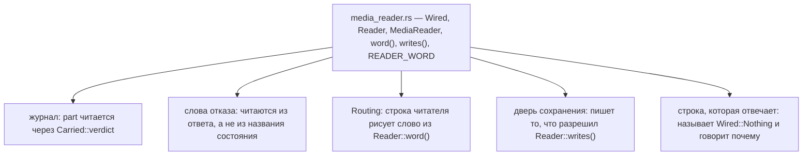

# Правило 1: словарь и те, кто его читает

**Главная мысль: словарь живёт в `rules/src/media_reader.rs`, и каждый, кому он нужен, читает
его оттуда. Файл, который называет состояние сам, читает факт второй раз.**

Слово, которого у таблицы языка нет, сказано как его говорит программа, а не как догадка.
`READER_WORD` назван один раз: `audio` не правило этого файла, и `text` не требует читателя.

Проверяет: `scripts/check_media_reader.py`, список READERS. Отрицательный тест —
`scripts/test_guards_fail.py`.
