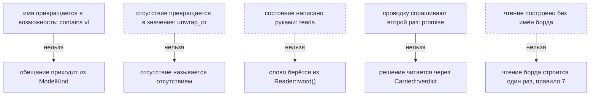

# Правило 2: что файл не может сказать

**Главная мысль: пять вещей нельзя сказать второй раз — возможность из имени, отсутствие как
значение, состояние руками, факт, который файл решил сам, и чтение без имён борда.**

Здесь нет «правильного значения по умолчанию». Отсутствие, превращённое в значение, — это ответ,
которого правило не давало, и борд начинает говорить одно, а отказ — другое.

Проверяет: `scripts/check_media_reader.py`, список MAY_NOT. Отрицательный тест —
`scripts/test_guards_fail.py`.
