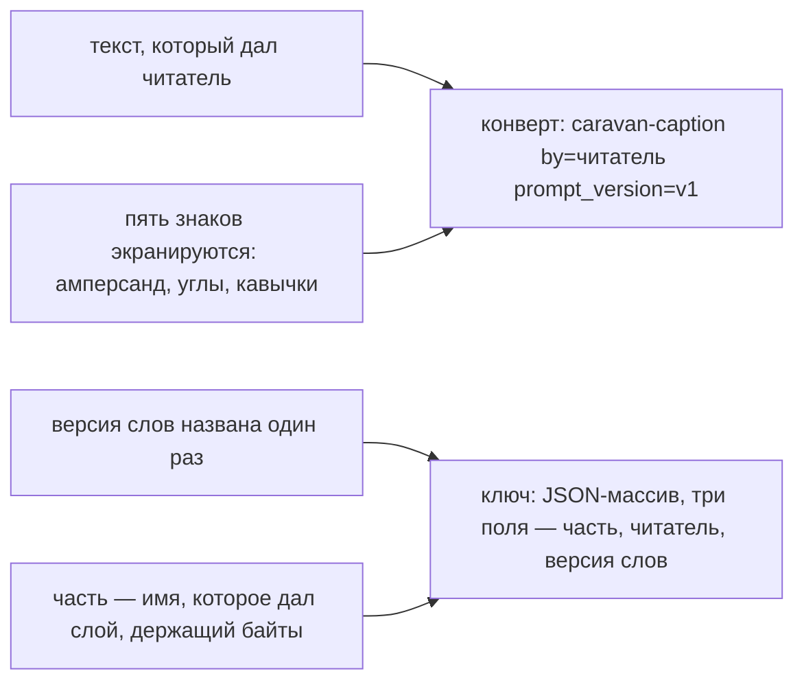

# Правило 3: форма подписи, поля ключа, версия слов

**Главная мысль: подпись — данные, а не слова модели. Ключ — массив, а не склейка.**

Текст читателя, который пишет `<`, остаётся текстом: конверт не кончается раньше, и слова не
становятся инструкцией.

Ключ, собранный склейкой, дал бы двум разным подписям одно имя, если имя читателя или версия
содержат разделитель — это то, что кеш не умеет.

Пула в ключе нет: та же картинка, прочитанная тем же читателем теми же словами, — одна и та же
подпись для любого пула.

Проверяет: `scripts/check_media_reader.py`, проверка ONCE (подпись и ключ могут быть названы только в
`media_reader.rs`), случаи `caption` и `key` в `contract/media_reader.json`.
