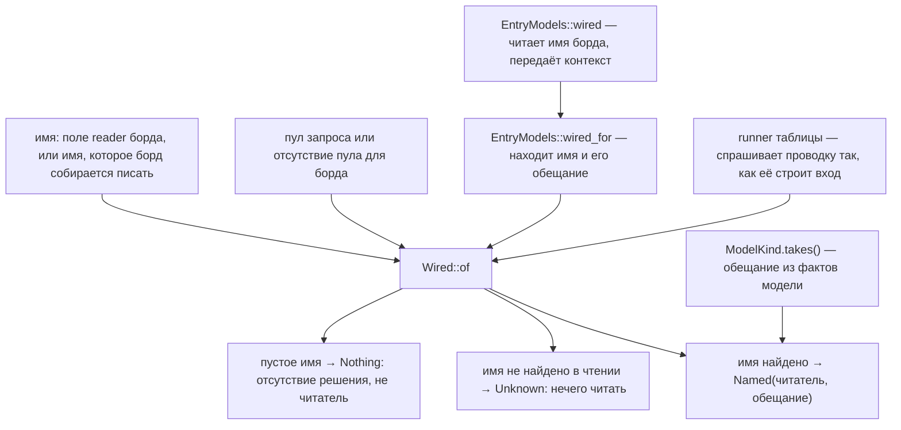

# Правило 4: где строится проводка

**Главная мысль: проводка строится в одном месте — `Wired::of`. Обещание ей даёт `ModelKind`, и
ничто не читает возможность из имени.**

Имя читателя — одно для всего борда. `wired` передаёт его в `wired_for`, а тот строит проводку
через `Wired::of`. Runner таблицы тоже вызывает `Wired::of`. Обещание приходит из `ModelKind`,
а не из имени.

Для запроса передаётся имя пула: если оно совпало с читателем, ответ — `itself`. Для строки
борда и сохранения пул не задан, поэтому `itself` там невозможен. Дверь сохранения спрашивает
`can_write` до записи; борд и клиент читают один ответ, а не два правила.

Проверяет: `scripts/check_media_reader.py` (проверка built), случаи `wired` в
`contract/media_reader.json`.
