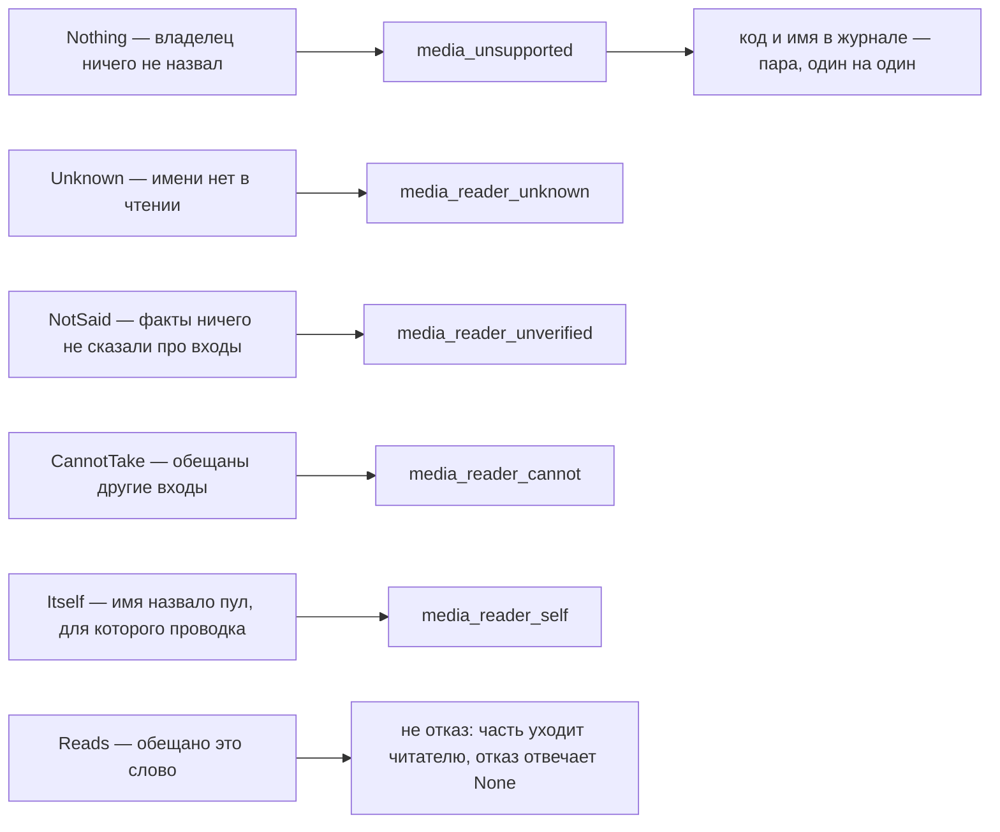

# Правило 5: один ответ — один код

**Главная мысль: шесть ответов — шесть разных отсутствий, и у каждого свой код и своё имя в
журнале. Одна фраза для всех была бы ошибочным советом.**

Два порядка важны:

- `Itself` отвечает **до** обещания. Это не вопрос о том, что модель берёт: подпись пришла бы от
  строки, которая не может прочитать часть.
- «проведи читателя» — правильный совет там, где читателя нет, и неправильный там, где он уже
  проведён или где имя нечем проверить. Поэтому код говорит, какое именно отсутствие видит отказ.

Проверяет: `scripts/check_media_reader.py`, список CODES: один код на один ответ, один раз, с именем для
журнала — `entry:media-unsupported`, `entry:media-reader-unknown`, `entry:media-reader-unverified`,
`entry:media-reader-cannot`, `entry:media-reader-self`), случаи `words` в
`contract/media_reader.json` — они отвечают и тем, кто не отказывается.
