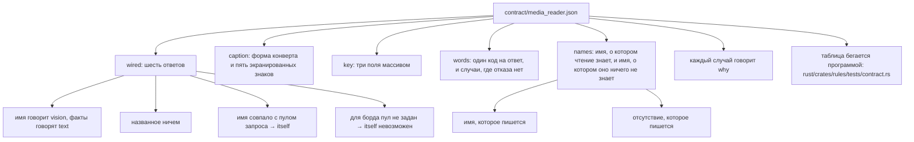

# Правило 6: таблица и случаи, которых в ней не может не быть

**Главная мысль: таблицу бегает программа. Таблица, которую никто не бегает, ничего не держит, и
случай без `why` держит правило, а не причину.**

Правило, которое требует присутствия, а не копии:

- таблица из одних отказов не отличает правило от догадки — нужны два случая, где отказа нет:
  проводка, которая читает слово, и строка, которая читает картинка сама;
- группа `names` не может состоять из одних `unknown`: иначе она не отличает имя, которого караван
  не знает, от чтения, которое не смотрит на модели;
- два ответа, которые пишутся (`Reads` и отсутствие), — это два факта, поэтому у каждого свой
  случай. Один случай может покраснеть только если он единственный свидетель;
- `for_pool` отличает запрос от борда: одно имя может дать `itself` для запроса и `reads` без
  пула. Это не две проводки: читатель у борда один.

`contract/media_reader_board.json` отдельно проверяет строку, единственный ключ проводки и форму
сохранения читателя борда. `itself` не показывается в строке: она спрашивает без пула.

Проверяет: `scripts/check_media_reader.py`, проверка STATES и условия присутствия случаев; `scripts/test_guards_fail.py` —
каждый случай, который правило требует, краснеет, когда его убирают.
