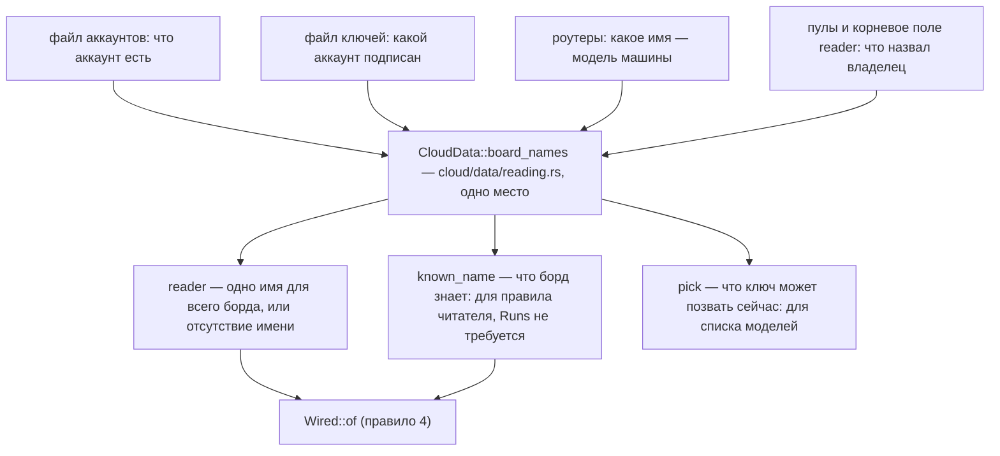

# Правило 7: чтение, из которого спрашивается правило

**Главная мысль: правило спрашивается из чтения, которое держит имена борда. Чтение из одних пулов
отвечает `unknown` на любое имя модели — и это факт о чтении, а не о модели.**

Два вопроса держатся отдельно одним флагом (`open_to`): что борд знает и что ключ может позвать
сейчас. Имя, которое борд знает и не может позвать, всё равно имеет факты, против которых его
читают, — и `unknown` остаётся ответом для имени, которого нет ни в одном месте чтения.

Живой случай, из-за которого правило написано: 2026-11-06 `gpt-6-luna` отказывался
`media_reader_unknown`, хотя факты подписки говорят, что он берёт `image`. Дверь сохранения
спрашивала правило из чтения пулов.

Блок читателя и дверь сохранения спрашивают то же чтение без пула. Запрос использует того же
читателя, но передаёт свой пул для проверки `itself`. Если бы блок спрашивал `pick`, он мог бы
сказать `unknown` об известной, но не запущенной модели.

Проверяет: `scripts/check_media_reader.py`, проверка READING (и список MAY_NOT для файла чтения), группа `names` в
`contract/media_reader.json`, пины в `scripts/test_guards_fail.py`.
