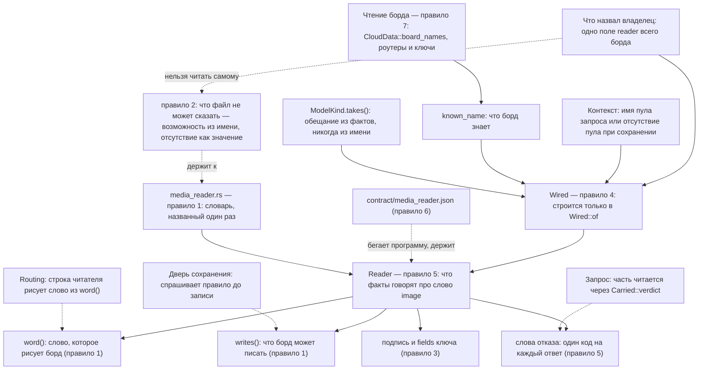

# Читатель: все правила одним видом

**Главная мысль: правило решает по фактам, и каждый факт назван один раз. Всё, что решает по
имени, — тот дефект, из-за которого это написано.**

## Что здесь держится

- **Имя — не обещание.** `qwen3-vl-8b-instruct` с фактами `text` — текстовая модель. Обещание
  приходит из `ModelKind`, и только оттуда.
- **Шесть ответов — шесть разных отсутствий.** Ничего не названо, имени нет в чтении, факты
  ничего не сказали, обещаны другие входы, имя назвало само себя, и один ответ, который читает.
  Одна фраза для всех была бы ошибочным советом.
- **Отсутствие названо отсутствием.** Пустое имя — это отсутствие решения владельца, а не читатель,
  который читает ничего. Пустое имя при записи — это снятие проводки.
- **Один читатель на весь борд.** Он хранится в корневом поле `reader`, не в пуле. При запросе
  имя пула нужно только для проверки `itself`; при сохранении и показе строки пула нет.
- **Факт о чтении и факт о модели — не одно и то же.** Ответ `unknown` говорит о чтении: правило
  спрашивается из чтения, которое держит имена борда (правило 7).

Что ещё видно на схеме и не является правилом этого файла: блок читателя на Routing и дверь
сохранения — два читателя одного факта; они не решают, они читают ответ.

Проверяет: `scripts/check_media_reader.py`, все семь правил; по одной диаграмме на каждое правило —
`diagrams/README.md`.
